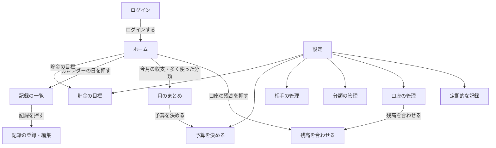

# 家計簿アプリ 画面設計書

## 1. この文書について

[要件定義書](要件定義書.md) の機能を、どの画面で・どのように使うかを決める。データの持ち方は [データベース設計書](データベース設計書.md) のとおり。

- 画面の図（ワイヤーフレーム）は、線と文字だけで「何を・どこに置くか」を表す。色やフォントなどの見た目は、6 章で決める。
  - ほかに考えた案：画面の図を画像にする。選ばなかった理由：文字と記号なら設計書の中にそのまま書け、直したところが Git の変更の記録でわかるため。
- 案を比べるときの下書きは、[画面の下書き](画面の下書き.html)（ブラウザで開く）にある。下書きの「選んだことの一覧」で、何と何を比べてどれを選んだかが見られる。
- README に載せる画面の画像は、作ったあとの本物の画面にする。
  - ほかに考えた案：下書きの画像を載せる。選ばなかった理由：下書きは本物の画面と見た目がちがい、読む人がまちがえるため。また、下書きのままの画面では見づらさがある（画面設計の下書きも、見やすいように変えてある）。
- 金額などの数字は、すべて例。

## 2. 画面一覧

| No | 画面 | URL | 段階 | 何をする画面か |
|---|---|---|---|---|
| 1 | ログイン | `/login` | 1 | ログインする。第 2 段階で、パスワードを表示するボタンを足す |
| 2 | ホーム | `/` | 1 | 今の残高、今月の収支（ひと目でわかる数字だけ）、今月のカレンダー、記録するボタン。第 2 段階で、使える額・カレンダーの予定・金額が未入力のお知らせ（押すとその場で開き、金額を入れられる）を足す |
| 3 | 記録の一覧 | `/records` | 1 | 記録を見る・探す。第 2 段階で検索・絞り込みを足す |
| 4 | 記録の登録・編集 | `/records/create`<br>`/records/{id}/edit` | 1 | 収入・支出・移動を入力する。新しい相手もここで追加できる |
| 5 | 月のまとめ | `/summary` | 1 | 月を切りかえて（過去の月も）、収支・分類ごとの合計・相手ごとの合計を見る。第 3 段階で予算の状況とグラフを足す |
| 6 | 口座の管理 | `/accounts`<br>`/accounts/create`<br>`/accounts/{id}/edit` | 1 | 口座の追加・変更・削除・使わない、最初の残高 |
| 7 | 残高を合わせる | `/accounts/{id}/adjust` | 1 | 実際の金額を入れて、差を「調整」の記録として残す。ホームの残高の一覧と、口座の管理から開く |
| 8 | 分類の管理 | `/categories`<br>`/categories/create`<br>`/categories/{id}/edit` | 1 | 大分類・小分類の追加・変更・削除・使わない |
| 9 | 相手の管理 | `/partners`<br>`/partners/create`<br>`/partners/{id}/edit` | 1 | 相手の追加・変更・削除・使わない |
| 10 | 定期的な記録 | `/recurrings` | 2 | 上：月ごとの金額（月を切りかえて、見る・入れる・直す）。下：予定の登録・変更・使わない |
| 11 | 予算を決める | `/budgets` | 3 | ふだんの予算と、特別な月だけの予算を決める。予算の状況は月のまとめで見る |
| 12 | 設定 | `/settings` | 1 | 定期的な記録・口座・分類・相手・予算・貯金の目標の画面へのリンクを並べる。スマホのメニューの「設定」から開く（パソコンでは、左のメニューに全部出る） |
| 13 | 貯金の目標 | `/goals`<br>`/goals/create`<br>`/goals/{id}/edit` | 3 | 貯金の目標の追加・変更・削除と、進み具合（選んだ口座の残高 ÷ 目標額） |

- URL は、扱うテーブルの名前を最初に置く（例：口座 → accounts → `/accounts`）。月のまとめは、1 つのテーブルではなく記録を集計する画面なので、「まとめ」の英語 summary にした。
- `{id}` には、記録や口座の番号が入る（例：5 番の記録の編集 → `/records/5/edit`）。
- 口座・分類・相手・定期的な記録の追加・変更は、一覧とは別の画面でする（5.6 で決めた。記録の登録・編集と同じ動きにして、どの画面でも同じ手順で使えるようにするため）。URL は、一覧の URL のあとに追加は `/create`、変更は `/{id}/edit` をつける。
- ログアウトは画面ではなく、メニューのボタン。
- 設定は、1 つのテーブルではなく、ほかの画面へのリンクを並べる画面なので、「設定」の英語 settings にした。

**画面一覧を決めるときに考えたほかの案**

- **月のまとめ（No.5）**：集計を、ホームと記録の一覧に分けて出す。選ばなかった理由：見たい集計があちこちに散らばり、どこで何を見るか迷うため。ホームは今月のひと目でわかる数字だけにし、くわしい集計は月のまとめに集めた。
- **残高を合わせる（No.7）**：記録の登録の中で、調整の金額を入れる。選ばなかった理由：差を自分で計算して入れるのは面倒で、続かないため。実際の金額を入れるだけで差を出してくれる小さな画面にした。
- **予算とグラフ（No.5・No.11）**：
  - ア：予算の状況とグラフを 1 つの画面に集める。選ばなかった理由：見やすいが、分類の表（月のまとめ）と円グラフ（この画面）が別の画面に分かれ、同じ月を見るのに行き来するため。
  - イ：月のまとめ（表とグラフ）と、予算だけの画面に分ける。選ばなかった理由：表とグラフが並ぶのはよいが、予算だけの画面は味気ないため。
  - 選んだもの：月のまとめに収支・分類・相手・グラフを全部並べ、予算の状況は分類の表の中に出す。予算を「決める」のは、たまにしかしないので別の小さな画面（No.11）にした。
- **第 1 段階で作るもの**：第 1 段階は、記録と今月の集計だけの最低限にする。選ばなかった理由：1 回目のデプロイが下書きのような画面になり、使えるアプリとして見せられないため。過去の月（要件定義書 No.17）と相手ごとの合計（No.16）を第 1 段階に移し、見た目もきちんと作る。

## 3. 画面遷移

### 3.1 メニュー

よく使う画面は常に見えるところに出し、たまにしか使わない画面は「設定」にまとめる。どの画面からでも、1 回押すだけで記録の登録画面へ行けるようにする（記録はいちばんよく使う操作で、たどり着くまでの手間が多いと続かないため）。

| | スマホ | パソコン |
|---|---|---|
| メニューの場所 | 画面のいちばん下（親指で押しやすい） | 画面の左側 |
| 常に出すもの | ホーム・記録の一覧・＋（記録する）・月のまとめ・設定 | ホーム・記録の一覧・月のまとめ・定期的な記録・口座・分類・相手・予算・貯金の目標 |
| 記録する | メニューのまん中の「＋」 | 画面の右下に浮かべた「＋ 記録する」ボタン |
| ログアウト | 画面の上 | 画面の上 |

- ログイン画面には、メニューを出さない。
- ログアウトのボタンは、青緑の枠・丸い形で、左に「扉から外へ出る」印をつける。カーソルを合わせたとき（スマホでは押したとき）は、うすい青緑（#dff2f0）を下にしく。
  - 選んだ理由（本人）：灰色では味気ないが、目立ちすぎるのも問題。ログアウトは毎日押すものではないので、青緑のぬりつぶしは「＋ 記録する」「保存」など大事なボタンにとっておく。
  - ほかに考えた案：色は、灰色の枠（味気ない）／帯ごと青緑にぬる（使える額のカードと色がぶつかり、広い面を青緑でぬるのは 6.3 の決まりにない）／枠なしで字と印だけ（押せると気づきにくい）。形は、字だけ／印＋字（四角に近い形）／スマホでは印だけ（字がないと何のボタンか迷う）。カーソルを合わせたときは、青緑でぬりつぶす（大事なボタンと同じになる）／うすい灰色（ボタンの色が 2 つにわかれる）／赤（赤は削除・まちがいの色で、ログアウトはデータを消さないので意味がずれる）。
- 定期的な記録（第 2 段階）と予算・貯金の目標（第 3 段階）は、その段階になってからメニューに足す。
- ほかに考えた案：全部の画面を 1 つのメニュー（「≡ メニュー」を押すと開く一覧）にまとめる。選ばなかった理由：作りはかんたんだが、記録するのに「メニューを開く → 記録する」の 2 手かかり、毎日のことなので面倒になるため。

### 3.2 画面遷移図

メニュー（3.1）からは、ログイン以外のどの画面へも行ける。下の図は、メニュー以外の移り方（画面の中のボタンやリンク）を表す。



- ログインしていないときは、どの画面を開いてもログイン画面になる。ログアウトしたときも、ログイン画面に戻る。
- 記録の登録・編集で保存したあとにどの画面へ行くか（元の画面に戻る、続けて次を入力する など）は、記録の登録・編集の画面の設計（5 章）で決める。

## 4. 全画面に共通の決まり

| | 決まり | 理由 |
|---|---|---|
| 1 | 画面の幅に合わせて並べ方を変える（レスポンシブ）。パソコンでは四角（ブロック）を横に並べ、スマホでは縦 1 列にする | 家ではパソコン、外ではスマホで、思い出したその場で入力できるようにするため |
| 2 | 入力のまちがいは、その欄のすぐ下に赤い字で出す（例：「金額は 1 円以上で入れてください」）。入れた内容は消さない | どこが・なぜまちがいかがすぐわかり、全部を入れ直さなくて済むため |
| 3 | 保存・削除できたときは、画面の上に「保存しました」などと数秒だけ出す | ちゃんと保存されたかを確かめられるようにするため |
| 4 | 金額は 3 けたごとにカンマで区切る（12,800）。マイナスは「-」をつけて赤い字にする | 読みまちがいを防ぎ、カードの残高などのマイナスを目立たせるため |
| 5 | 日付は「10月9日（金）」の形にする。今年でないときだけ年をつける | 曜日があると、いつのことかを思い出しやすいため |
| 6 | データがまだないとき（記録が 0 件など）は、空白にせず「まだ記録がありません」と、次にすること（「＋ 記録する」など）を出す | 使い始めに、何をすればよいかわかるようにするため |
| 7 | 日付と時刻は日本時間で扱う | サーバー（AWS）はシドニーにあるため、明示しておく |
| 8 | 削除の前に、確認の小窓（ダイアログ）を出す：「この記録を削除しますか？［削除する］［やめる］」 | 削除は元に戻せないため。削除は毎日する操作ではないので、1 手増えても負担は小さい |
| 9 | 記録がある口座・分類・相手・定期的な記録は削除できない（要件定義書 5.4）。削除を押したときは「記録があるので削除できません。『使わない』にしますか？」と出す。記録がなくても、定期的な記録が使っている口座・分類・相手と、貯金の目標が使っている口座は削除できず、何が使っているかと、そこへのリンクを出す。「使わない」にするときも、「使う」でまだ終わっていない定期的な記録や、貯金の目標が使っているときは止めて、同じように出す（要件定義書 5.4） | 削除できない理由と、かわりにできることがすぐわかるようにするため |
| 10 | 画面に出す文（まちがいのお知らせなど）は、この設計書の文どおりにし、「〜を入れてください」のような、やわらかい言い方にそろえる。文は `lang/ja/` に、使う分だけ自分で書く。新しい入力チェックを使うときは、その文も足す | 設計書で決めた文をそのまま出し、アプリ全体の言い回しをそろえるため |
| 11 | ブラウザの「戻る」で、ブラウザがとっておいた前の画面が出たときは、読みこみ直して今の中身で出す。ただし、まだ保存していない打ちかけの入力があるときは、読みこみ直さずにそのまま出し、上に「前の画面を出しています。残高などが古いかもしれません［読みこみ直す］」を出す。保存して別の画面へ移ったあとの「戻る」は、今までどおり読みこみ直す | 古い残高をそのまま見せないため。打ちかけの入力を黙って消さないため。保存した画面から 2 回目を送らないため |
| 12 | 画面を開いたまま時間がたって保存できなかったとき（フォームの合言葉が古くなったとき）は、エラーの画面を出さずに前の画面に戻し、入れた内容を欄に戻して、上に「画面を開いてから時間がたっていたので、操作できませんでした。入れた内容は残してあるので、もう一度押してください。」を出す。ログインも切れていたときは、入れた内容を取っておき、ログインの画面で「ログインが切れていたので、操作できませんでした。ログインし直すと、入れた内容を欄に戻します。」を出す。ログインし直すとその画面に戻り、欄に戻して「ログインする前に入れた内容を、欄に戻しました。確かめてから、もう一度保存してください。」を出す（1 日より古いものは戻さない。パスワードは取っておかない）。Livewire の画面（記録の登録など）では、画面を出したまま、上に「画面を開いてから時間がたっていたので、操作できませんでした。［読みこみ直す］を押すと、入れた内容を欄に戻します（ログインが切れていたら、ログインし直したあとに戻します）。」を出し、開き直した同じ画面で欄に戻す。画面の上の知らせは 1 つにして、新しい知らせが出たら入れかえる | 英語のエラーの画面で、入れた内容が黙って消えないようにするため |
| 13 | 開いた・保存した口座・分類・相手・記録・定期的な記録・目標が、ほかの画面で削除されていたときは、エラーの画面を出さずに、その一覧に戻して上に「この〇〇は、ほかの画面で削除されていました。」を出す。変更の画面から保存したとき（打った内容を持って変更の画面へ戻ってきたときも）は、打った内容を追加の画面の欄に入れて「保存していません。打った内容を入れておいたので、保存すると新しい〇〇として追加できます。」を出す（小分類の大分類も削除されていたときは、一覧で打った名前を出す）。削除を 2 回押したときは「この〇〇は、もう削除されています」、相手のまとめるを 2 回押したときは「この相手は、もうまとめられているか、削除されています」を出す。選んだ口座・分類・相手（まとめ先もふくむ）が保存の途中で削除されていたときは、同じ画面で選び直してもらう | エラーの画面で、入れた内容が黙って消えないようにするため。何も保存していないのに「保存しました」と出さないため |
| 14 | ほかの画面の保存と重なって保存できなかったとき（データベースが押さえあいで止めて、3 回やり直してもできなかったとき）は、エラーの画面を出さずに、送った画面に戻して入れた内容を欄に戻し、上に「ほかの画面の保存と重なったので、保存できませんでした。入れた内容は残してあるので、もう一度押してください。」を出す。Livewire の画面では、画面を出したまま上に同じ文を出す。何件かまとめて保存する画面（ホームのお知らせ・月ごとの金額）は、全部保存するか、何も保存しないかのどちらかにする。送った画面がわからないときは、ほかの画面の欄に入れないように、入れた内容を持たずにホームで「画面を開き直して、もう一度入れてください。」と出す | 途中まで保存されたのに「保存できませんでした」と出したり、ほかの画面の欄に打った内容を入れたりしないため |

**ほかに考えた案**

- 1：パソコンだけ、またはスマホだけに合わせる。選ばなかった理由：上の表の理由のとおり、どちらでも使いたいため。
- 8：確認なしで削除し、あとで元に戻せるようにする。選ばなかった理由：元に戻す仕組みを作るのは大変で、確認の 1 手のほうが負担が小さいため。
- 10：翻訳の部品（laravel-lang）を入れて、全部の文の日本語をそろえる／部品を入れて、ログインの文だけ書きかえる。選ばなかった理由：部品の文は「認証に失敗しました」「メールは必須項目です」のような言い回しで、設計書の文と合わない。書きかえると、自分の文と部品の文がまざって、言い回しがそろわないため。

## 5. 画面ごとの設計

画面ごとに、次の 4 つを決める。

1. URL
2. 出すもの（ワイヤーフレーム）と、どのテーブルから取るか
3. 入力欄とチェック
4. ボタンと、押したらどこへ行くか

### 5.1 ログイン

**URL**：`/login`

**出すもの**

```
┌──────────────────────────┐
│           家計簿            │
│                            │
│ メールアドレス               │
│ [                        ] │
│ パスワード                  │
│ [                        ] │
│                            │
│ [✓] ログインしたままにする     │
│                            │
│        [ ログイン ]          │
└──────────────────────────┘
```

- 使うテーブル：users
- メニューは出さない（3.1）。
- ユーザー登録とパスワードリセットのリンクは出さない（要件定義書 5.7）。
- パスワードの欄の右はしに、目のマークのボタンを置く（要件定義書 No.22。1 回目のデプロイのあとに、スマホとパソコンでログインしてみて足すと決めた）。押すと打った字が見え、マークが斜線つきの目に変わる。もう一度押すと隠れる。ログインを押して送るときは、隠した形に戻す（ブラウザのパスワードを覚える機能が、パスワードの欄だと気づけるように）。
  - ほかに考えた案：B 欄の下に「パスワードを表示する」のチェックボックスを置く。C 目のマークを押している間だけ見せる。選ばなかった理由：B は字があってわかりやすいが、欄から離れていて、行が 1 つ増える。C は、スマホで押したまま確かめるのがやりにくい。
- ユーザーの作成とパスワードの変更は、コマンドで行う（`php artisan user:create`・`php artisan user:password メールアドレス`。使い方は README）。パスワードは画面に字を出さずに 2 回聞き、12 文字以上にする。パスワードを変えたら、ほかの機械でのログインも終わらせる。
  - ほかに考えた案：コマンド 1 つで、ユーザーがいればパスワードを変え、いなければ作る。選ばなかった理由：メールアドレスを打ちまちがえると、変えるつもりで新しいユーザーを作ってしまうため。コマンドを作らず tinker で直接書く。選ばなかった理由：パスワードが画面と履歴に残り、12 文字以上などのチェックもされないため。

**入力欄とチェック**

| 欄 | チェック |
|---|---|
| メールアドレス | 必須。メールアドレスの形 |
| パスワード | 必須 |
| ログインしたままにする | 最初からチェックを入れておく |

- メールアドレスかパスワードがちがうときは、「メールアドレスかパスワードがちがいます」と出す。どちらがちがうかは言わない。
- 続けてまちがえたときは、しばらくログインできなくする（Laravel にある仕組みを使う。1 分に 5 回まで）。数えるのは、メールアドレスと IP アドレスの組み合わせごと。最初にまちがえてから 60 秒のあいだに 5 回まちがえると、6 回目からは、最初にまちがえてから 60 秒たつまで「ログインの回数が多すぎます。○ 秒後にもう一度ためしてください」と出す（○ は残りの秒数。Laravel の最初の値のまま）。
- 「ログインしたままにする」にチェックを入れると、ブラウザを閉じてもログインが続く。自分のスマホ・パソコンでは毎回ログインしなくて済み、人のパソコンではチェックを外せる。
  - ほかに考えた案：この欄を置かず、毎回ログインする／欄を置くが、最初はチェックなしにする。選ばなかった理由：個人で使うので、毎回ログインをするのは面倒であり、使う人がめんどくさくならない設計を心がけているため。

**ボタンと移り先**

| ボタン | 押したら |
|---|---|
| ログイン | 合っていればホームへ。ログインする前にほかの画面を開こうとしていたときは、その画面へ |

### 5.2 ホーム

**URL**：`/`

**出すもの**

カード型にする（6.1）。上から「急ぎのこと → 今いくら使えるか・今いくらあるか・今月どうか・目標 → どの日にいくら → 最近」の順に並べる。小さなカード（今の残高の合計・今月の収支・多く使った分類・貯金の目標）は横 2 列にして、使える額のすぐ下に置く。パソコンでは、使える額を左半分、小さなカード 4 つ（2×2）を右半分に並べ、カレンダーのカードは横いっぱいに広げる（4 章の 1）。

- **小さなカードをカレンダーより上にした**（第 3 段階で並べかえた。2026-10-16）。選んだ理由（本人）：使える額・残高の合計・収支・分類・貯金の目標を、同じところで見られるとよいため。
  - はじめの形：小さなカードはカレンダーの下。選ばなかった理由：使える額と、残高・収支・目標が離れていて、いっしょに見られないため。

```
┌──────────────────────────────┐
│ 家計簿                  ログアウト │
├──────────────────────────────┤
│ お知らせ                        │ ← 第2・3段階。あるときだけ出る
│  金額がまだのものが 3 件あります ▼ │
│  趣味・娯楽が予算をこえました     ▶ │
├──────────────────────────────┤
│ 使える額          37,900 円     │ ← 第2段階。いちばん大きな、色つきのカード
│  1日あたり 1,647 / 1週間 11,529  │
├───────────────┬──────────────┤
│ 今の残高の合計  │ 今月の収支      │
│  352,900      │  -48,600       │
│  口座ごと ▼    │ 収入0・支出48,600│
├───────────────┼──────────────┤
│ 多く使った分類  │ 貯金の目標      │ ← 第3段階
│  食費 18,200   │  旅行 40%       │
│  趣味・娯楽 …  │  車の買いかえ 30%│
├───────────────┴──────────────┤
│ 今月（10月）のカレンダー          │
│  日   月   火   水   木   金   土 │
│                    1    2    3 │
│   4    5    6    7    8  [ 9]  10│ ← [ ] は今日（太い枠）
│      1,200       890 3,240  680  │
│  11   12   13   14   15   16  17 │
│                     5.2万        │ ← 灰色：これからの予定（第2段階）
│  …                             │
├──────────────────────────────┤
│ 最近の記録                      │
│  10月9日（金）コンビニ       680  │
│                記録の一覧へ ▶    │
├──────────────────────────────┤
│ ホーム 記録の一覧 ＋ 月のまとめ 設定 │ ← スマホのメニュー（3.1）
└──────────────────────────────┘
```

| カード | 段階 | 中身 | 使うテーブル |
|---|---|---|---|
| お知らせ | 2・3 | 下の「お知らせ」のとおり。何もないときは、カードごと出さない | recurrings・recurring_amounts・recurring_skips・accounts・records・budgets |
| 使える額 | 2 | 使える額をいちばん大きな字で出す。その下に 1 日あたり・1 週間あたりの額と、計算の内訳（「今の合計」「− 取っておく額」「− 今月末までの予定」の 3 行。押すと、予定の 1 件ずつが開く） | accounts・records・recurrings・recurring_amounts・recurring_skips |
| 今月のカレンダー | 1 | 下の「カレンダー」のとおり | records・recurrings・recurring_amounts・recurring_skips |
| 今の残高の合計 | 1 | 口座の今の残高の合計（今の残高は、今日までの日付の記録で計算する。下の「計算の決まり」）。「口座ごと」を押すと、その場で口座ごとの残高が開く。「使わない」口座は出さない。取っておく額がある口座は、その額も小さく出す（第 2 段階） | accounts・records |
| 今月の収支 | 1 | 今月の収入・支出・差 | records |
| 多く使った分類 | 1 | 今月、多く使った大分類 3 つと、その額 | records・categories |
| 貯金の目標 | 3 | 目標ごとの進み具合（％）を、一覧（5.13）と同じ順で。達成した目標は出さない。目標がないときは「まだ目標がありません。押すと追加できます」、全部達成したときは「全部の目標を達成しました」 | goals・accounts・records |
| 最近の記録 | 1 | 最後に入力した記録 5 件（入力した順）。入れたものがちゃんと入ったかを、すぐ確かめられるようにする | records・categories・partners・accounts |

**カレンダー**

- 今月だけを出す。ホームでは月を切りかえない（前の月は、記録の一覧で見る）。今日のマスは、基本の色の太い枠にする。
- マスには、その日の支出の合計（ふつうの字）、収入の合計（緑の太字）、まだ記録されていない定期的な記録（灰色。第 2 段階）を出す。移動と調整は出さない（月の合計と同じ数え方）。色は 6.3 のとおり。
- これからの予定は、灰色の数字としてカレンダーに入れる。予定だけの一覧は、ホームには出さない。
- スマホではマスが小さいので、1 万円以上は「12.2万」のように短く出す（小数 1 けたまで、四捨五入。250,000 → 25万、121,600 → 12.2万）。パソコンでは金額をそのまま出す。それでもマスに入らないときは、マスの外にはみ出さないように、マスの中で切る。
- 第 1 段階では、使える額・貯金の目標のカードはなく、カレンダーには支出と収入だけが出る。

**計算の決まり**

- **今の残高は、今日までの日付の記録で計算する。** 先の日付で入れた記録（例：来週払う旅行代金）は、その日になったら残高に入る。それまでは、カレンダーのその日のマスと、記録の一覧のその日のところに出る。残高を合わせる画面（5.7）の「アプリの残高」も今日までの残高なので、2 つの画面の残高が食いちがわない。
  - ほかに考えた案：日付に関係なく、全部の記録を残高に入れる。選ばなかった理由：今日までの残高なのに、その先の予定の支出を入れて食いちがうのはおかしいため。
  - 今月の先の日付の記録は、今の残高には入らないが、今月の収支・多く使った分類・カレンダー（その日のマスに、ふつうの記録と同じ字で）には、その日の分として入る。記録の一覧・月のまとめの月の合計と同じ数え方にするため。
- 使える額 ＝ 今の合計残高 − 取っておく額の合計 − 今月末までに引き落とされる予定（要件定義書 5.5）。予定には、まだ記録されていない定期的な記録の支出と、手で入れた明日から今月末までの日付の支出をふくめる（例：10月11日に、10月20日の旅行代 50,000 を先に記録したら、11日の時点で 50,000 引く）。
- **取っておく額は、口座ごとの今月末の見込みの残高で数える。** 見込みの残高 ＝ 今の残高 − 今月末までの予定の支出 ± 予定の移動（予定は上と同じく、手で入れた先の日付の記録もふくむ。収入は足さない）。例：25日に銀行口座から貯金用の口座（全部取っておく）へ 30,000 円移す予定があれば、20日の時点で貯金用の口座の取っておく額を 30,000 円多く数える。こうすると、移した日に使える額が急に減らない。
  - ほかに考えた案：今の残高で数える。選ばなかった理由：アプリを使う人にとって必要なのは使える額がいくらなのかということなので、取っておく額に予定を反映しておかないとおかしいため。移す日の前は、移す予定のお金まで使える額に入ってしまう。
- **取っておく額は、その口座の見込みの残高の分までしか引かない。** 例：銀行口座が 150,000 円で取っておく額が 200,000 円なら、引くのは 150,000 円。見込みの残高がマイナスのときは、「金額」でも「全部取っておく」でも 0 円とする（マイナスを引いて使える額がふえないようにするため）。「金額」の口座で足りないときは、お知らせ「○○ が取っておく額を下回っています」で知らせる。「全部取っておく」口座は、いつも残高と同じ額を取っておくので、このお知らせは出さない。
  - ほかに考えた案：決めた額を全部引く（足りない分は、ほかの口座のお金で埋める考え方）。選ばなかった理由：取っておく額はあとから変えることもあり、給料の前などに口座が少し下回るたびに使える額がマイナスになると、続けて使う目的（要件定義書 2 章）に合いにくいため。
- **日付が過ぎたのに金額がまだの予定も、金額を入れるか「今回はなし」にするまで、概算で予定として引く。** お金はもう出ているので、引いておくほうが本当の使える額に近いため。今月の分は、カレンダーの記録する日のマスにも灰色で出しつづけ、まだ入れていないことに気づけるようにする。過ぎた月の分（「金額がまだ」のお知らせに出るもの）も、使える額からは引く（カレンダーは今月だけなので出ない）。
  - ほかに考えた案：日付が過ぎたら、使える額とカレンダーの予定から外す。選ばなかった理由：払ったのに記録されていない分だけ使える額が多く出て、使いすぎるおそれがあるため。
- 1 日あたり ＝ 使える額 ÷ 今月の残りの日数（今日をふくむ）。1 円未満は切り捨て（マイナスのときも 0 に近いほうへ。-1,647.28 → -1,647）。
- 1 週間あたり ＝ 1 日あたり × 7。月末まで 7 日ないときは、残りの日数をかける。
- 使える額がマイナスのときは、1 日あたり・1 週間あたりも、マイナスのまま赤い字で出す。
- 月末まで 7 日ないときは、「1週間」のかわりに「あと○日」と出す（かける日数が 7 でないことがわかるように）。
- 合計にも取っておく額にも、「使わない」口座は入れない（いつも 0 円なので、合計は変わらない）。
- 手で入れた先の日付の「調整」は、マイナス（へらす）のときだけ、支出と同じに予定として引き、見込みの残高も動かす。プラスは収入と同じく足さない。その日が来たときに、使える額が急に変わらないようにするため。
- 内訳の予定の名前は、定期的な記録はその名前、手で入れた記録は相手の名前（移動・調整は「移動」「調整」）。金額がまだのものには「概算」の印をつける。
- カレンダーの灰色の予定は、支出はそのまま、収入は「+」をつける（ふつうの記録と同じ見分け方）。移動は出さない。
- お知らせの「今回はなし」を押したときは、使える額とカレンダーの予定も変わるので、ホームを出し直す。ほかの欄に打ちかけていた金額は消さずに残し、入力欄も開いたまま出す。

**お知らせ**

| お知らせ | 段階 | 出るとき | 押したら |
|---|---|---|---|
| 金額がまだのものが ○ 件あります | 2 | 金額が変わる定期的な記録で、今月の分か過ぎた月の分に、金額が入っていないものがあるとき（くわしくは表の下） | その場で開いて、金額を入れられる（下の「入力欄とチェック」） |
| ○○ が取っておく額を下回っています | 2 | 取っておく額が「金額」の口座で、今月末の見込みの残高（下の「計算の決まり」）が、取っておく額より少ないとき。今の残高で足りていても、予定の引き落としで下回るときは先に知らせる | 口座の管理へ |
| ○○ が予算をこえました（+○ 円） | 3 | 今月、その分類で使った額が予算をこえたとき | 月のまとめへ |
| ○○ が予算の ○% です（あと ○ 円） | 3 | 今月、その分類で使った額が予算の 80% 以上になったとき（80% ちょうどもふくむ）。大分類と小分類の両方に予算があり、どちらも当てはまるときは両方出す | 月のまとめへ |

- 予算のお知らせの ○○ は、小分類なら「食費 › 外食」のように大分類の名前をつける（食費の下と日用品の下に同じ名前の小分類があっても、どの予算のことかわかるように）。字の色は、こえたら赤、まだこえていなければオレンジ（6.3）。

- 「金額がまだ」に出すもの：
  - **今月の分**＝お金が動く日（土日・祝日でずらしたあとの日）が今月のもの（日付が過ぎたものもふくむ）。もとの予定の月がちがうときは、その月の印をつける（前の平日にずれて今月に動く来月分は「11月の分」、次の平日にずれて今月に動く先月分は「10月の分」）。
  - **過ぎた月の分**＝お金が動く日が先月以前で、まだ金額がないもの。金額を入れるか「今回はなし」にするまで出つづけ、「9月の分」の印をつけていちばん上に出す。
- お金が動く日が来月以降のものの金額は、ホームでは入れない。定期的な記録の画面の「月ごとの金額」で入れる（5.10）。
- 記録のつけ忘れを知らせるお知らせは作らない。給料など決まったものは「金額がまだ」のお知らせで、ふだんの買い物は「最近の記録」の日付で気づける。
- **過ぎた月に金額を入れ忘れた予定も、「金額がまだ」に出しつづける。** 金額を入れると、予定の日付で記録する（要件定義書 No.13）。
- **お知らせの「今月の分」は、お金が動く日で数える**（カレンダー・使える額と同じ。5.10）。例：毎月 1日・前の平日の引き落としは、2026年11月1日が日曜なので 10月30日に動く。この 11 月分は、10 月のお知らせに「11月の分」として出す。
  - ほかに考えた案：もとの予定の月（11 月）になってから出す。選ばなかった理由：気づいたときには引き落としの日が過ぎているため。「11月の分」と教えてもらえば十分わかりやすい。
- 過ぎた月の分についてほかに考えた案：①今月の分だけ出す。②月が変わったら、金額がまだのものを自動で「今回はなし」にする。選ばなかった理由：電気代がなくなることはそうそうないし、入れ忘れたままで過ごしてしまえば正確な残高にならず、使える額もおかしくなってしまうため（①は入れ忘れがお知らせから消えて記録されないまま、②は払ったものを「なし」にしてしまう）。

**ホームを決めるときに考えたほかの案**

- **予算をホームでどう出すか**：ア 予算を決めた分類の残りを全部並べる／ウ ホームには出さない。選ばなかった理由：アは予算を決めた数だけ行が増え、残高や収支が下へ押し出される。ウは使いすぎていても、月のまとめを開くまで気づかない。気にするべきもの（80% 以上・こえたもの）だけをお知らせに出す（イ）。
- **取っておく額**：全体で 1 つの金額にする。選ばなかった理由：貯金用の口座のように、口座ごとに考えるほうが自然なため。口座ごとに決め、「全部取っておく」も選べるようにした。
- **1 日あたり・1 週間あたり**：使える額だけを出す。選ばなかった理由：今日どれだけ使っていいかの目安を作りたかったため。
- **貯金の目標**：目標ごとに、貯めた額を自分で入れる。選ばなかった理由：入れる手間が増えるため。貯金用の口座の残高をそのまま使えば、何も入れずに進み具合がわかる。
- **記録のつけ忘れのお知らせ**：何日か記録がないと知らせる。選ばなかった理由：上のとおり、ほかのしくみで気づけるため。
- **ホームの四角をドラッグで並べかえる**：今作る。選ばなかった理由：まず決まった並び順で作り、使ってみて必要になったら足す（要件定義書 5.7）。

**入力欄とチェック**

お知らせの「金額がまだ」を開いたときだけ、入力欄が出る。

| 欄 | チェック |
|---|---|
| 金額（定期的な記録ごと） | 空でもよい（空のものは保存しない）。入れるときは 1 円以上の整数。欄には概算を薄い字で出しておく |

- 「今回はなし」を押したものは、その月は記録せず、お知らせからも消える。

**ボタンと移り先**

| ボタン・リンク | 押したら |
|---|---|
| お知らせ（金額がまだ） | その場で開く・閉じる |
| まとめて保存 | 入れた金額を保存してホームに戻る。日付が今日か過ぎていたものは、このときに予定の日付で記録する |
| 今回はなし | その月は記録しないことにして、お知らせから消す |
| カレンダーの日 | 記録の一覧（5.3）の今月を開き、その日の見出しのところまで動く。その日に記録がないときは、その日より前でいちばん近い記録のある日の見出しまで動く（なければ一覧のいちばん上） |
| 口座ごと | その場で、口座ごとの残高を開く・閉じる |
| 口座ごとの残高の行 | 残高を合わせる（5.7）へ |
| 今月の収支・多く使った分類のカード | 月のまとめ（5.5）の今月へ |
| 貯金の目標のカード | 貯金の目標（5.13）へ |
| 最近の記録の行 | 記録の編集（5.4）へ |
| 記録の一覧へ | 記録の一覧（5.3）へ |

### 5.3 記録の一覧

**URL**：`/records`（今月）、`/records?month=2026-09`（ほかの月）

- `?month=` のあとに、見たい月を「年-月」で書く。何も書かないときは今月を出す。

**出すもの**

1 か月ずつ出す。日付ごとに見出しをつけ、新しい日が上。

```
┌──────────────────────────────┐
│ 家計簿                  ログアウト │
├──────────────────────────────┤
│      ‹    2026年10月    ›       │
│  収入 0 / 支出 48,600 / 差 -48,600│
├──────────────────────────────┤
│ 10月9日（金）          支出 890  │
│  コンビニ                  680  │
│   食費 · 現金 · おにぎり          │
│  駅                       210  │
│   交通費 · 交通系IC               │
│ 10月8日（木）        支出 2,350  │
│  現金 → 交通系IC          3,000  │ ← 移動は灰色
│  調整                     -200  │ ← 調整
│   現金                          │
│  スーパー                2,350  │
│   食費 > 食料品 · 現金            │
│ 10月1日（木）              支出 0 │
│  会社                 +250,000  │ ← 収入は緑
│   給料 · 銀行口座                │
├──────────────────────────────┤
│ ホーム 記録の一覧 ＋ 月のまとめ 設定 │
└──────────────────────────────┘
```

| 場所 | 中身 | 使うテーブル |
|---|---|---|
| 月の切りかえ | 「‹」で前の月、「›」で次の月 | — |
| 月の合計 | その月の収入・支出・差（収入 − 支出）。移動と調整は入れない（ホームの今月の収支と同じ数え方） | records |
| 日付の見出し | 日付と、その日の支出の合計。収入・移動・調整は足さない。記録のない日は出さない | records |
| 記録の行 | 下の「行の出し方」のとおり | records・accounts・categories・partners |

**行の出し方**

| 種類 | 1 行目（大きい字） | 金額 | 2 行目（小さい字） |
|---|---|---|---|
| 支出 | 相手 | `680` | 分類 · 口座 · 品物（品物は入れたときだけ） |
| 収入 | 相手 | `+250,000`（緑） | 分類 · 口座 |
| 移動 | どこから → どこへ | `3,000`（灰色） | なし |
| 調整 | 「調整」 | `+300` か `-200` | 口座 |

- 分類は、小分類があるときは「大分類 > 小分類」と出す（例：食費 > 外食）。
- 同じ日の中も、あとで入力したものを上にする。
- メモは一覧には出さない（編集画面で見る）。
- 「使わない」にした口座・分類・相手も、元の名前のまま出す（要件定義書 5.4）。
- 定期的な記録から自動で作られた記録には、小さく「自動」と出す（第 2 段階）。金額などを直しても「自動」は残る（定期的な記録から作られたことは変わらないため）。
- その月に記録がないときは、「この月の記録はまだありません」と「＋ 記録する」ボタンを出す（4 章の 6）。

**第 2 段階：検索・絞り込み（要件定義書 No.18）**

- 月の切りかえの横に「探す」ボタンを足す。押すと、期間・口座・分類・相手・品物（言葉の一部）の欄が開く。
- 探しているあいだは、月の切りかえのかわりに「条件」と「○ 件」を出し、合計も見つかった記録だけで計算する。「条件を消す」で今月の一覧に戻る。
- 見つかる範囲の決まり（月のまとめから開いたときに、合計が月のまとめの金額と同じになるようにする）：
  - **分類**：大分類で探すと、その下の小分類の記録もふくめて見つかる。小分類の欄は「すべて」「小分類なし」と、その大分類の小分類から選ぶ。
  - **口座**：その口座から出た記録・入った記録（移動の「どこへ」をふくむ）・調整が見つかる（5.7 の最近の記録と同じ）。
  - **相手**：支出も収入も見つかる。月のまとめの「相手ごとの支出」から開いたときは、「支出だけ」の条件もつけて開き、条件の表示に「支出」と出す。
  - **品物**：打った言葉をふくむもの（一部が合えばよい）。メモは探さない。`%` や `_` も、ふつうの文字として探す。大文字・小文字、ひらがな・カタカナ、全角・半角の英数字、全角・半角のカナは同じとして探し、濁点・半濁点（ハ・バ・パ）、小さいカナ（ヤ・ャ、ツ・ッ）、アクセント（cafe・café）はちがうものとして探す（ちがう品物が見つかって、合計に入らないように）。半角のカナと記号（ｰ･｢｣､｡ など）は、品物を保存するときに全角にそろえる（ﾊﾟﾝ → パン、ｰ → ー。前に入れた品物も、そろえ直してある。メモはそろえない）。
- 探しているときの日付の見出しの「支出」は、その日の見つかった記録の支出の合計。
- 一覧に 1 回で出すのは 500 件まで（何年分もの記録を 1 ページに出して、とても遅くなったり、エラーの画面になったりしないため。要件定義書 N-12）。月ごとの一覧（探していないとき）も同じ。
  - こえたときは、一覧の上に「○ 件のうち、1〜500 件目を出しています（新しい順）」と出し、いちばん下に「続きを見る（あと ○ 件）」を出す。押すと、次の 500 件までを出す（URL に `before=2026-09-01.1234` のような続きの印をつける）。続きのページの上には「最初から見る」を出す。
  - 続きは「前のページのいちばん下の記録より前（古いほう）」で出す。ページ番号で出すと、ほかの画面で記録を消したときに、記録が飛ばされて見えなくなるため。続きを開いたときに続きの記録がなくなっていたら「この続きの記録はありません」と「最初から見る」を出す。
  - 件数と合計は、ほかのページの記録もふくめて数える。日が 2 つのページにまたがるときは、見出しに「（続きは次のページ）」「（前のページから続く）」と出し、見出しの「支出」はその日の全部の分にする。
  - ホームのカレンダーの日（5.2）から開いて、その日が 1 ページ目にないときは、その日から始まる続きのページを開き直す。
  - 月ごとの一覧の「続きを見る」「最初から見る」と、ホームのカレンダーの日のリンクには、見ている月も URL に入れる（開いたまま 0 時をこえて月が変わっても、同じ月の続きを出すため）。
  - 続きのページから記録の編集を開いたとき、「‹ やめる」は同じ続きのページに戻る。保存・削除のあとは 5.4 のとおり（月ごとの一覧から開いたときは、その記録の月の一覧の最初のページ、探した一覧から開いたときは、同じ条件の同じページ）。
- 条件は URL のうしろに書く（例：`/records?from=2026-10-01&to=2026-10-31&category=3&sub=none`）。読みこみ直しても「戻る」でも、同じ条件の結果が出る。
- 探しているときは、月の切りかえのところに「探した結果 ○ 件」と条件（「期間 2026年10月1日〜2026年10月31日」「分類 食費 > 小分類なし」など）を出し、その下に「条件を変える」（欄を開く。今の条件が入っている）と「条件を消す」を出す。分類の条件は、小分類で探すと「大分類 > 小分類」、大分類だけで探すと「大分類（小分類もふくむ）」と出す。
- 条件に合う記録がないときは「条件に合う記録はありません」と出す。
- 見つかった記録の行から編集の画面を開いて、保存・削除・やめるをしたときは、同じ条件の一覧に戻る（探し直さなくてよいように）。

**入力欄とチェック**

「探す」の欄。どれも空でよい（空の欄は「どれでもよい」）。入れた欄は全部「かつ」でつなぐ。

| 欄 | 中身 | チェック |
|---|---|---|
| 期間 | 始めの日・終わりの日（日付を選ぶ欄）。片方だけでもよい（「○日から」「○日まで」） | ある日付であること。両方入れたときは、終わりの日が始めの日と同じかあと |
| 種類 | すべて・支出・収入 | 月のまとめの相手の行から開いたときは「支出」が入っている |
| 口座 | すべてと、口座の管理の順の口座。「使わない」口座も、うしろに「（使わない）」をつけて出す（前の記録を探すため） | 見つかる口座であること |
| 大分類 | すべてと、支出・収入のまとまりごとの大分類（分類の管理の順）。「使わない」分類も出す | 見つかる大分類であること |
| 小分類 | すべて・小分類なし・選んだ大分類の小分類。大分類が「すべて」のときは選べない | 選んだ大分類の中の小分類であること（古い URL で、小分類をほかの大分類へ移したときなど） |
| 相手 | すべてと、相手の管理と同じ 3 つのまとまり（使った相手は最近使った順・まだ使っていない相手・使わない相手） | 見つかる相手であること（古い URL で、ほかの相手にまとめたときなど） |
| 品物 | 言葉の一部 | 255 文字まで |

- チェックに通らない条件があるときは、欄を開いて、その欄の下に赤い字で知らせを出し、記録は出さない（まちがった条件を黙って外して探さないため）。
- 欄を全部空のまま「探す」を押したときは、「探す条件を 1 つ以上入れてください」と出す（何も起きないように見えないため）。

**ボタンと移り先**

| ボタン・リンク | 押したら |
|---|---|
| ‹ ・ › | 前の月・次の月の一覧へ |
| 記録の行 | 記録の編集（5.4）へ。削除も編集画面でする |
| ＋ 記録する（記録がないとき） | 記録の登録（5.4）へ。今月でないときは、その月の 1 日を日付の最初の値にする（見ている月の記録をつけたいときに、日付を探さずに済むように。今月のときは今日） |

### 5.4 記録の登録・編集

**URL**：`/records/create`（登録）、`/records/{id}/edit`（編集）

**出すもの**

いちばん上で種類（支出・収入・移動）を切りかえる。切りかえると、下の欄が種類に合わせて入れかわる。欄は、毎回入れる金額をいちばん上に置く。相手は、分類と口座より上に置く（相手を選ぶと、その下の分類と口座が入るため。下の「相手を選んだときの決まり」）。

```
支出・収入のとき                    移動のとき
┌──────────────────────────┐   ┌──────────────────────────┐
│ [支出]  収入   移動          │   │  支出   収入  [移動]         │
│                            │   │                            │
│ 金額   [            680] │   │ 金額   [          3,000] │
│ 日付   [10月9日（金）  ▼] │   │ 日付   [10月9日（金）  ▼] │
│ 相手   [コン            ] │   │ どこから [現金        ▼] │
│        ┌─────────────┐  │   │ どこへ   [交通系IC    ▼] │
│        │ コンビニ       │  │   │ メモ   [                ] │
│        └─────────────┘  │   │                            │
│ 分類   [食費          ▼] │   │ [ 保存 ]                   │
│ 小分類 [なし          ▼] │   │ [ 保存して続けて入力 ]      │
│ 口座   [現金          ▼] │   └──────────────────────────┘
│ 品物   [おにぎり        ] │     ※ 品物は支出のときだけ出す
│ メモ   [                ] │
│                            │
│ [ 保存 ]                   │
│ [ 保存して続けて入力 ]      │
└──────────────────────────┘
```

- 使うテーブル：records・accounts・categories・partners
- 編集のときは、ボタンが「保存」と「削除」になる（「保存して続けて入力」は出さない）。
- 調整の記録を編集するときは、種類の切りかえを出さず、「調整」と書いて、金額・日付・口座・メモだけを出す。金額のチェックは「0 以外の整数」（プラスもマイナスも入れられる。0 にはできない。データベース設計書 3.5）。
- **「使わない」口座の記録は、その口座の残高が 0 円でなくなる直し・削除はできない**（金額・口座・日付を変える、削除する）。「この記録を直すと、『使わない』口座の旧カードの残高が 5,000 円になるので、保存できません。先に旧カードを『使う』に戻してから直してください」と出す。メモ・分類・相手・品物の直しは、今までどおりできる。「使わない」口座はいつも 0 円、という前提を守るため（5.6）。
  - ほかに考えた案：①「使わない」口座の記録は、どこも直せない・消せない。選ばなかった理由：メモや分類のように、残高に関係ない直しまでできなくなるため。②直せるようにして、0 円でなくなったらホームに出して知らせる。選ばなかった理由：「使わない」口座が出たり出なかったりして、決まりが複雑になるため。
- 「最後」「いちばん新しい」の決め方：
  - 口座の最初の値の「その種類で最後に保存した記録」は、新しく登録した記録のうち、いちばんあとに保存したもの（入力した日時で決める。編集したものはふくめない）。
  - 相手を選んだときの「いちばん新しい記録」は、その相手の記録のうち、日付がいちばん新しいもの（今日までの日付。同じ日なら、あとで入力したもの）。
- 「＋ つけ忘れを記録する」（5.7）から開いたときは、口座はその口座のまま変えない（相手を選んでも、口座は入れかえない。分類・小分類は入れる）。

**最初から入れておく値（登録のとき）**

| 欄 | 最初の値 | 理由 |
|---|---|---|
| 種類 | 支出 | いちばん多いので、支出ならそのまま入れられる |
| 日付 | 今日 | 要件定義書 5.3 |
| 口座（移動はどこから・どこへ） | その種類で、最後に保存した記録と同じ口座 | 同じ口座で続けて買い物をした日に、選ばずに済む。「使わない」にした口座だったときは空にする。相手を選ぶと、その相手の前回の口座に入れかわる（下の「相手を選んだときの決まり」） |
| そのほか | 空 | |

**入力欄とチェック**

| 欄 | 支出 | 収入 | 移動 | チェック |
|---|---|---|---|---|
| 金額 | 必須 | 必須 | 必須 | 1 円以上、99,999,999 円（1 億円未満）までの整数。スマホでは数字のキーボードを出す。欄は文字の欄にして、打ち終えて欄を離れたら「1,000,000」のようにカンマをつける（欄に戻ったら外す）。カンマや全角の数字で打っても受けとる。上限は、0 の打ちすぎに気づけるようにするためで、ほかの金額の欄（最初の残高・調整・定期的な記録・予算・目標額）も同じ上限にする（最初の残高と調整はマイナスも同じ大きさまで） |
| 日付 | 必須 | 必須 | 必須 | 正しい日付。2000年1月1日から、今日の 1 年先まで（年の打ちまちがいに気づけるように。「日付は 2000年1月1日 から 2027年10月13日（今日の 1 年先）までで入れてください。」）。上の区切りは今日から数えるので、何年たっても止まらない。欄の下に「10月20日（火）・あと 7 日」のように、曜日と今日から何日かを出す（1 年以内の打ちまちがいにも気づけるように。4 章の 5） |
| 口座 | 必須 | 必須 | — | 「使わない」口座は選べない |
| どこから・どこへ | — | — | 必須 | 同じ口座は選べない（「どこから と どこへ に同じ口座は選べません」） |
| 分類 | 必須 | 必須 | — | 支出のときは支出用、収入のときは収入用の大分類だけを出す |
| 小分類 | 任意 | 任意 | — | 選んだ分類の小分類だけを出す。分類を変えたら空に戻す |
| 相手 | 必須 | 必須 | — | 下の「相手の欄」のとおり |
| 品物 | 任意 | — | — | 100 文字まで |
| メモ | 任意 | 任意 | 任意 | 1,000 文字まで |

- 「使わない」にした口座・分類・相手は、選ぶ欄や候補に出さない（要件定義書 5.4）。ただし、編集する記録にもともと入っているものは、そのまま出す。
- 種類を切りかえても、金額・日付・メモは消さない。分類・小分類は空に戻し、口座は、その種類で最後に保存した記録と同じ口座にする（最初の値と同じ決まり）。
- 小分類がない分類を選んだときは、小分類の欄を「なし」にして押せなくする。
- **日付の範囲**（2026-10-13、本人と決めた）：はじめは 2000〜2099 年にしたが、本人の「2100 年になったらどうなる？」で、決まった年で区切ると、その年をすぎたら保存できなくなるとわかった。ア 2099 年まで／イ 今日の 1 年先まで／ウ 今日の 10 年先まで、をサブエージェントにも聞いて比べ、イに、曜日と「あと ○ 日」を出す案を足した。選んだ理由：年が変わっても止まらず、2062 年・2036 年のような打ちまちがいも止められる。1 年より先の記録を手で入れる場面はほとんどない（定期的な記録はその日に自動で作る）。ウは 10 年以内の打ちまちがいが通るため、「1 年より先なら確認の小窓を出す」案は、近い先の予定を入れるたびに聞かれてうるさいため選ばなかった。
- **金額の欄の形**（2026-10-13、本人と比べて決めた）：ア 文字の欄＋数字のキーボード／イ 数字だけの欄（type="number"）／ウ アに、欄を離れたらカンマをつける、を下書きで打って比べ、ウにした。選んだ理由：打ち終えると 1,000,000 のように見え、0 の打ちすぎに気づきやすい（金額に上限をつけた理由と同じ）。イは、カンマなどを打つと空で届いて欄が空になり、パソコンではホイールで金額が変わることがあるため選ばなかった。打ちながらカンマをつけないのは、文字の位置がずれて打ちにくいため。最初の残高・残高を合わせるの実際の金額・調整の金額の欄（マイナスも入れる）も、この形にそろえた（2026-10-14、残高を合わせる画面を作るときに画面で確かめた）。マイナスは、全角の「－」や、日本語入力のままの「ー」で打っても受けとる（日本語入力を切りかえずに打てるように）。入力の欄の中の字は、マイナスでも赤くしない（2026-10-14、本人と決定）。入力の欄の赤は、まちがいの印（赤い枠と欄の下の赤い字）に使っていて、マイナスで正しい場面（クレジットカードの最初の残高など）もあるため。マイナスは、表示の金額（残高・差など）で赤く出る（4 章の 4）。

**相手の欄**

- 文字を打つと、その文字をふくむ登録済みの「使う」相手が、すぐ下に候補として出る（最近使った順に 8 つまで）。押すとその相手が入る。
- 候補にない名前のときは、「＋ ○○ を新しい相手として追加します」と出す。記録を保存したときに、相手もいっしょに追加する（要件定義書 No.7）。
- 「使わない」にした相手と同じ名前を打ったときは、新しく作らず、その相手を「使う」に戻して使う（同じ名前の相手が 2 つできないようにするため）。そのときは「『○○』は『使わない』の相手です。保存すると『使う』に戻して使います」と出す。
- 打ちまちがいで似た相手ができたときは、相手の管理（5.9）で直す。
- ほかに考えた案：相手は一覧（▼）から選び、ないときは一覧のいちばん下の「＋ 新しい相手」を押して、小窓で名前を入れる。選ばなかった理由：打ちまちがいは起きないが、相手が 50 件、100 件と増えると一覧が長くなり、探す手間が増えるため。打つ形なら数文字で見つかり、打ちまちがいは相手の管理の「ほかの相手にまとめる」で直せる。

**相手を選んだときの決まり**（要件定義書 5.3）

- 新しく登録するときに相手を選ぶと、その相手・同じ種類（支出か収入か）のいちばん新しい記録から、分類・小分類・口座を入れる。すでに選んであっても入れ直す。そのあと自分で選び直せる。
- その相手の記録がまだないとき（新しい相手など）は、何も変えない（口座は「前回と同じ口座」のまま）。
- 入れようとした分類・口座が「使わない」になっているときは、その欄は空にする。
- 編集のときは、相手を選び直しても、ほかの欄は変えない（直したい欄だけを直せるようにするため）。

**ボタンと移り先**

| ボタン | 押したら |
|---|---|
| 支出・収入・移動 | 下の欄を、その種類の欄に入れかえる |
| 保存（登録） | 保存して、この画面を開く前の画面（ホーム・記録の一覧など）に戻る |
| 保存して続けて入力 | 保存して、同じ画面のまま、種類・日付・口座は残し、ほかの欄を空にする。夜にレシートをまとめて入れるときに使う |
| 保存（編集） | 保存して、元の画面に戻る。記録の一覧から開いたときは、その記録の月の一覧に戻る（「探す」で探した一覧から開いたときは、同じ条件の一覧に戻る） |
| ‹ やめる（左上、見出しの左） | 保存せずに、この画面を開く前の画面（見ていた月の一覧など）に戻る。登録・編集の両方に出す |
| 削除（編集） | 確認の小窓（4 章の 8）のあと削除して、元の画面に戻る。定期的な記録から自動で作られた記録のときは、小窓で「10月のカードA の引き落としは『今回はなし』になり、自動では記録されません」と出し、削除したらその月を「今回はなし」にする（第 2 段階。5.10）。まちがえて消したときは、月ごとの金額の「もどす」で戻せる |

- どの保存でも、画面の上に「保存しました」と出す（4 章の 3）。
- **「‹ やめる」の置き場所**（2026-10-14、本人と下書きで比べて決めた。案 E は本人の案）：左上に「‹ やめる」を置く。
  - 選んだ理由：
    - 画面を開いてすぐ目に入る。「‹」で「ここから出る」場所だとひと目でわかる。
    - 言葉は「やめる」なので、保存しないことがわかる。削除の小窓の「やめる」ともそろう。
    - 保存から離れているので、押しまちがえにくい（保存のつもりで押して、直した内容が消えることがない）。
    - メニュー（3.1）の「記録の一覧」は今月を開くので、見ていた月に戻るには、この画面から戻る場所が要る。
  - 気になるところ：スマホを片手で持つと、左上は親指が届きにくい。保存ほど何度も押すボタンではないので、こちらを選んだ。
  - ほかに考えた案：
    - A 保存・削除の下に「やめる」：親指が届く下のほうで押しやすい。選ばなかった理由：保存のすぐ近くなので、保存のつもりで押すと、直した内容が消えるため。
    - D 左上に「やめる」（字だけ）：選ばなかった理由：字だけだとボタンに見えにくいため。
    - B 左上に「‹ 戻る」：選ばなかった理由：「戻る」は、保存してから戻るのか迷うことがあるため。
    - C 何もしない（メニューができるのを待つ）：選ばなかった理由：メニューの「記録の一覧」は今月を開くので、見ていた月に戻れないため。
- 編集のときは、種類を切りかえても口座（どこから・どこへ）は、もとの口座のままにする（登録のときのように、前回と同じ口座には入れかえない）。直したい欄だけを直せるようにするため（相手を選び直したときと同じ考え方）。

### 5.5 月のまとめ

**URL**：`/summary`（今月）、`/summary?month=2026-09`（ほかの月）

- 月の書き方は、記録の一覧（5.3）と同じ。

**出すもの**

切りかえ（タブ）は使わず、上から「収支 → 支出の分類 → 収入の分類 → 相手 → グラフ」の順に全部並べる。月を切りかえると、全部がいっしょに変わる。

```
┌──────────────────────────────┐
│ 家計簿                  ログアウト │
├──────────────────────────────┤
│      ‹    2026年10月    ›       │
├──────────────────────────────┤
│ 収支                            │
│  収入 250,000 / 支出 182,400     │
│  差 +67,600                     │
├──────────────────────────────┤
│ 支出の分類                       │
│  (円グラフ) ← 第3段階            │
│  住まい            70,000 ▶    │
│  食費              42,300 ▼    │
│   食料品           29,500 ›    │
│   外食             12,800 ›    │
│   └ 予算 10,000 ■■■■ 2,800 こえた │ ← 第3段階
│  ローン            30,000 ▶    │
│              予算を決める ▶      │ ← 第3段階
├──────────────────────────────┤
│ 収入の分類                       │
│  給料             250,000 ›    │
├──────────────────────────────┤
│ 相手ごとの支出                    │
│  不動産会社         70,000 ›    │
│  銀行（ローン）      30,000 ›    │
│  …（多い順に 5 件）              │
│          ほかの相手も見る ▼       │
├──────────────────────────────┤
│ 月ごとの収入・支出（棒グラフ）      │ ← 第3段階
│ 全体の残高の移り変わり（折れ線）    │ ← 第3段階
├──────────────────────────────┤
│ ホーム 記録の一覧 ＋ 月のまとめ 設定 │
└──────────────────────────────┘
```

| 四角 | 段階 | 中身 | 使うテーブル |
|---|---|---|---|
| 月の切りかえ | 1 | 「‹」で前の月、「›」で次の月 | — |
| 収支 | 1 | その月の収入・支出・差（収入 − 支出）。移動と調整は入れない（5.3 と同じ数え方） | records |
| 支出の分類 | 1 | 大分類ごとの支出の合計。大分類を押すと、その下に小分類が開く | records・categories |
| 収入の分類 | 1 | 大分類ごとの収入の合計。小分類の開き方は支出と同じ | records・categories |
| 相手ごとの支出 | 1 | 相手ごとの支出の合計。多い順に 5 件。「ほかの相手も見る」で全部出す | records・partners |
| 円グラフ | 3 | 支出の大分類ごとの割合。支出の分類の表のすぐ上。金額の多い順に 5 つと、残りをまとめた「ほか」の 6 色まで（色が多いと見分けにくいため。表には全部出る） | records・categories |
| 予算の状況 | 3 | 予算を決めた分類の行の下に「予算 ○○」と棒。こえたときは赤、80% 以上でまだこえていないときはオレンジ（ホームのお知らせと同じ決まり。6.3） | budgets |
| 月ごとの収入・支出 | 3 | 選んだ月までの 6 か月分の棒グラフ | records |
| 全体の残高の移り変わり | 3 | 選んだ月までの 6 か月分、各月末の合計残高の折れ線グラフ。今月は今日までの残高。最初の残高は、使い始めた月（下）の初めからあったものとして、どの月の残高にも入れる。「使わない」口座も、過去の月の残高に入れる（その月には使っていたため） | accounts・records |

- 月ごとの収入・支出と、全体の残高の移り変わりのグラフは、使い始めた月（いちばん古い記録の月と、最初に口座を作った月の早いほう）より前の月は出さない。0 円の月が並んで、残高が急に増えたように見えないため。
- 選んだ月に記録がないときも、前の月の分があれば、棒グラフと折れ線グラフは出す（「この月の記録はまだありません」の下）。月を進めても、それまでの移り変わりが見えるようにするため。
- 来月から先の月を選んだときは、折れ線グラフはその月まで線を引かない（まだ残高がないため）。棒グラフは、先の日付で入れた記録があれば、その月の月のまとめと同じ金額で出す。
- グラフの数字はサーバーで計算して画面に渡し、ブラウザのグラフの部品（Chart.js）は絵を描くだけにする。表とグラフの金額がずれないようにするため。
- 円グラフの横には、色・名前・割合（1 % 未満は切り捨て）を字で並べる。色だけにたよらず、スマホでもグラフにさわらずに読めるようにするため。棒グラフ・折れ線グラフも、画面を読み上げる機械のために、同じ数字を見えない表で持つ。
- 予算の状況は、分類の行のすぐ下に「予算 30,000 ■■■ あと 3,000（90%）」の形で出す。こえたときは「2,800 こえた」。

**数え方の決まり**

- 大分類の金額 ＝ その小分類の合計 ＋ 小分類を選ばなかった記録の合計。小分類を選ばなかった記録は、開いたときに「小分類なし」の行で出す（要件定義書 5.3）。
- 小分類を使った大分類は、名前の横に「小分類 ○」の札（「小分類なし」は数えない）と、右に下向きの矢印を出す。開くと矢印が上を向く。押すと何が出るかと、開けない行とのちがいがわかるようにするため（下書きで A〜E を比べて C に決定）。小分類を使っていない大分類は、開くものがないので矢印を出さない（第 2 段階からは、右の「›」で、その大分類で探した記録の一覧を開く）。「ほかの相手も見る」の矢印も同じ形にする。
- 分類・相手は、金額の多い順に並べる。同じ金額のときは、分類は分類の管理の並び順（「小分類なし」はいちばん下）、相手は追加した順。その月に 0 円のものは出さない。
- 「使わない」にした分類・相手も、その月に記録があれば元の名前のまま出す（要件定義書 5.4）。
- その月に記録がないときは、「この月の記録はまだありません」と出す（4 章の 6）。

**入力欄とチェック**

なし。

**ボタンと移り先**

| ボタン・リンク | 段階 | 押したら |
|---|---|---|
| ‹ ・ › | 1 | 前の月・次の月のまとめへ |
| 大分類の行 | 1 | その下の小分類を開く・閉じる |
| ほかの相手も見る | 1 | 6 件目からの相手を開く・閉じる |
| 小分類・小分類なし・相手の行の「›」 | 2 | 記録の一覧（5.3）を、その月・その分類（相手）で探した状態で開く。期間はその月の 1 日〜末日。相手の行は「支出」の条件もつける。小分類を使っていない大分類の行（押しても開くものがない行）も「›」をつけ、その大分類で探した一覧を開く |
| 予算を決める | 3 | 予算を決める（5.11）へ |

### 5.6 口座の管理

**URL**：`/accounts`（一覧）、`/accounts/create`（追加）、`/accounts/{id}/edit`（変更）

**出すもの**

一覧と、追加・変更の画面の 2 つに分ける（2 章）。

```
一覧                                追加・変更
┌──────────────────────────┐   ┌──────────────────────────┐
│ 口座の管理                  │   │ 口座を直す                  │
│                            │   │                            │
│ 銀行口座       412,000 ›  │   │ 名前   [銀行口座          ] │
│  取っておく額 200,000       │   │ 種類   [銀行口座        ▼] │
│ 現金             8,500 ›  │   │ 最初の残高 [      350,000] │
│ 交通系IC         2,300 ›  │   │  記録があるので変えられません │
│ カードA        -48,300 ›  │   │  残高を合わせる ▶           │
│                            │   │ 取っておく額  ← 第2段階     │
│ [ ＋ 口座を追加 ]           │   │  (•) なし                  │
│                            │   │  ( ) 金額 [       200,000] │
│ 使わない口座                │   │  ( ) 全部取っておく          │
│  旧カード            0 ›  │   │ [✓] 使う                   │
└──────────────────────────┘   │                            │
                                   │ [ 保存 ]  [ 削除 ]          │
                                   └──────────────────────────┘
```

| 場所 | 中身 | 使うテーブル |
|---|---|---|
| 口座の行 | 名前と今の残高。取っておく額があるときは、その下に小さく出す（第 2 段階） | accounts・records |
| 使わない口座 | 「使わない」にした口座を、一覧のいちばん下にまとめて薄い字で出す | accounts・records |

- 並べる順番は、種類ごと（銀行口座 → 現金 → 交通系 IC → クレジットカード）、同じ種類の中は追加した順。ホームの今の残高も同じ順にする。
- 口座がまだないときは、「まだ口座がありません。使っている口座を追加しましょう」と「＋ 口座を追加」を出す（4 章の 6）。

**入力欄とチェック**（追加・変更の画面）

| 欄 | チェック |
|---|---|
| 名前 | 必須。50 文字まで。ほかの口座と同じ名前はつけられない |
| 種類 | 必須。銀行口座・現金・交通系 IC・クレジットカードから選ぶ。貯金の目標が使っている口座は、クレジットカードに変えられない（「貯金の目標「旅行」がこの口座を使っているので、クレジットカードにできません。先に目標の口座を変えるか、目標を削除してください」と出し、目標へのリンクを出す。第 3 段階） |
| 最初の残高 | 必須。整数（クレジットカードなど、マイナスも入れられる）。その口座の記録が 1 件でもあるときは変えられない（下の決まり） |
| 取っておく額（第 2 段階） | 「なし」「金額」「全部取っておく」から選ぶ。「金額」のときは 1 円以上の整数。クレジットカードのときは出さない。種類をクレジットカードに変えて保存すると、取っておく額は「なし」に戻す |
| 使う | 変更の画面にだけ出す（追加した口座は、いつも「使う」から始まる）。最初はチェックあり。外すと「使わない」になる（要件定義書 5.4）。残高が 0 円のときだけ外せる（下の決まり。ここでの残高は、先の日付の記録もふくめた残高。今日 0 円でも、先の日付の記録で残高が変わる口座は外せない。そのときは「先の日付の記録で残高が変わるので、『使わない』にできません」と出す）。「使う」でまだ終わっていない定期的な記録や、貯金の目標が使っている口座も外せない（4 章の 9。分類・相手の管理の「使う」も同じ） |

- **「使わない」にできるのは、残高が 0 円の口座だけ。** お金が残っているときは「残高が 3,000 円あるので『使わない』にできません。お金をほかの口座へ移す記録をつけるか、残高を合わせて 0 円にしてください」と出し、「残高を合わせる」へのリンクを出す。削除を押して「使わない」にするかを聞くとき（4 章の 9）も同じ。「使わない」口座はホームに出さないが、いつも 0 円なので、出さなくても合計がずれないため。口座を使わなくなるときは、ふつうはお金を移し終わっているので、手間は小さい。
  - ほかに考えた案：①お金が残っていても「使わない」にでき、そのお金も合計には入れる。選ばなかった理由：口座ごとの行を足しても合計と合わなくなるうえ、使えないお金が使える額にも入りつづけるため。②お金が残っていても「使わない」にでき、そのお金は合計に入れない。選ばなかった理由：残っていたお金がどこにも出なくなり、過去の残高とも合わず、お金が消えたように見えるため。
- **最初の残高の決まり**：その口座の記録がまだないときだけ直せる。記録があるときは、欄を変えられなくして「記録があるので変えられません」と「残高を合わせる」へのリンクを出す。最初の残高を書きかえると、過去の月の残高まで変わってしまうため（データベース設計書 3.2）。
- 取っておく額の「全部取っておく」は、貯金用の口座など、残高を全部使える額から外したいときに使う。
- 金額の欄に打つと、「金額」を選んだことにする（「なし」のまま金額を打って保存し、打った金額が使われないことがないように）。「なし」「全部取っておく」を選び直して保存したときは、欄に残っている金額は使わない（選び直したことのほうを使う）。
- 種類を選ぶ欄でクレジットカードを選ぶと、取っておく額の欄は、その場で隠れる。

**ボタンと移り先**

| ボタン・リンク | 押したら |
|---|---|
| 口座の行 | その口座の変更の画面へ |
| ＋ 口座を追加 | 追加の画面へ |
| 保存 | 保存して、一覧に戻る |
| 削除（変更の画面） | 記録がないときは、確認の小窓（4 章の 8）のあと削除して一覧に戻り、「削除しました」と出す。記録があるときは「使わない」にするかを聞き（4 章の 9）、「『使わない』にする」を押すと一覧に戻って「『使わない』にしました」と出す。「使わない」にできないとき（上の決まり）は、できない理由と［閉じる］だけを出す |
| 残高を合わせる（変更の画面） | 残高を合わせる（5.7）へ |

### 5.7 残高を合わせる

**URL**：`/accounts/{id}/adjust`

**出すもの**

上で実際の金額を入れ、下でその口座の最近の記録を見られるようにする。残高がずれる理由でいちばん多いのは記録のつけ忘れなので、調整する前に、つけ忘れがないかを確かめられるようにするため。つけ忘れを調整で直すと、その分が分類ごとの合計に入らず、月のまとめが実際とずれてしまう。

```
┌──────────────────────────────┐
│ 現金の残高を合わせる               │
├──────────────────────────────┤
│  アプリの残高            8,000   │
│  実際の金額      [       8,500]  │
│  差                     +500    │
│  日付        [10月9日（金）  ▼]  │
│  メモ        [財布を数えた      ]  │
│                                │
│       [ 調整として保存 ]          │
├──────────────────────────────┤
│ つけ忘れはありませんか？            │
│ 現金の最近の記録                  │
│  10月9日（金）コンビニ       680  │
│  10月8日（木）現金 → 交通系IC 3,000│
│  …（10 件）                     │
│        ＋ つけ忘れを記録する       │
└──────────────────────────────┘
```

| 場所 | 中身 | 使うテーブル |
|---|---|---|
| アプリの残高 | その口座の、選んだ日付の終わりまでの残高（データベース設計書 3.5 の計算）。最初は今日なので、今日までの残高。日付を変えると、その日までの残高と差に変わる | accounts・records |
| 差 | 実際の金額 − アプリの残高。実際の金額を入れると、すぐに計算して出す。プラスは「+」、マイナスは赤（4 章の 4） | — |
| 最近の記録 | その口座が入っている記録（移動の「どこへ」もふくむ）を、新しい順に 10 件。出し方は記録の一覧（5.3）と同じ | records・categories・partners・accounts |

**入力欄とチェック**

| 欄 | チェック |
|---|---|
| 実際の金額 | 必須。整数（クレジットカードなど、マイナスも入れられる） |
| 日付 | 必須。最初は今日。今日までの日付から選ぶ（先の日付は選べない。数える前の金額はまだわからないため）。前の日を選ぶと、その日の終わりまでの残高とくらべる |
| メモ | 任意。1,000 文字まで |

- 差が 0 のときは「ずれはありません」と出し、保存ボタンを押せなくする（0 円の調整の記録はつくらない。データベース設計書 3.5）。
- 保存すると、差の金額で「調整」の記録をつくる（要件定義書 No.4）。最初の残高は書きかえない。
- 差は調整の記録の金額になるので、記録の金額と同じく ±99,999,999 円までにする。こえるときは「差が大きすぎます。一度に合わせられるのは、差が 99,999,999 円までです。」と出し、保存ボタンを押せなくする（あとで直せない記録をつくらないため）。
- 「使わない」口座は合わせられない（開くと「ページが見つかりません」）。「使わない」口座はいつも 0 円、という前提を守るため（5.6）。
- 左上に「‹ やめる」を置く（記録の登録・編集とそろえる。5.4）。保存せずに、開く前の画面に戻る。
- 最近の記録の行は、日付の見出しがないので、行の頭に日付を出す。行から記録を直したあとや、「＋ つけ忘れを記録する」で記録したあとは、この画面に戻り、「‹ やめる」の戻る先（開く前の画面）も覚えておく。
- **日付を前の日にしたときは、その日の終わりまでの残高とくらべる。** 例：10月9日に、10月6日に数えたメモ（実際 8,500）で合わせると、6日の終わりまでの残高 9,200 とくらべて -700 の調整を 6日の日付でつくる。保存すると、6日の残高が 8,500 になる。「何日に数えたか」と「その日の残高」がそろい、まちがった調整にならないため。
  - ほかに考えた案：①日付は今日だけにする。選ばなかった理由：前に数えたメモや、通帳の前の日の残高で合わせられないため。②日付は変えられるが、差はいつも今日の残高でくらべる。選ばなかった理由：その日のずれとちがう金額の調整ができてしまうため。

**ボタンと移り先**

| ボタン・リンク | 押したら |
|---|---|
| 調整として保存 | 調整の記録を保存して、この画面を開く前の画面（ホーム・口座の管理）に戻る |
| 最近の記録の行 | 記録の編集（5.4）へ |
| ＋ つけ忘れを記録する | 記録の登録（5.4）を、口座にこの口座を入れた状態で開く（相手を選んでも口座は入れかえない）。保存すると、この画面に戻る（アプリの残高と差は、記録した分だけ変わる） |

### 5.8 分類の管理

**URL**：`/categories`（一覧）、`/categories/create`（追加）、`/categories/{id}/edit`（変更）

- 小分類を追加するときは、どの大分類の下に作るかを URL の後ろにつける（例：食費の下 → `/categories/create?parent=1`）。大分類を追加するときは、収入用か支出用かをつける（例：`/categories/create?kind=expense`）。

**出すもの**

```
一覧                                小分類の変更
┌──────────────────────────┐   ┌──────────────────────────┐
│ 分類の管理                  │   │ 小分類を直す                │
│                            │   │                            │
│ 支出の分類                  │   │ 名前       [車          ] │
│ ⠿食費               ›   │   │ 親の大分類  [自動車      ▼] │
│   ⠿食料品           ›   │   │  この小分類の記録 12 件も    │
│   ⠿外食             ›   │   │  いっしょに移ります          │
│   ＋ 小分類を追加           │   │ [✓] 使う                   │
│ ⠿日用品             ›   │   │                            │
│   ＋ 小分類を追加           │   │ [ 保存 ]  [ 削除 ]          │
│  …                         │   └──────────────────────────┘
│  ＋ 大分類を追加            │
│                            │
│ 収入の分類                  │
│ ⠿給与               ›   │
│  …                         │
│  ＋ 大分類を追加            │
└──────────────────────────┘
```

（⠿ は並べかえのつまみ。点が 6 つ並んだ形）

| 場所 | 中身 | 使うテーブル |
|---|---|---|
| 支出の分類・収入の分類 | 支出用と収入用を分けて、別の四角に出す | categories |
| 大分類・小分類の行 | 大分類の下に、その小分類を 1 段下げて全部出す（管理の画面では閉じない） | categories |
| つまみ ⠿ | 各行の左に出す。押さえたまま上下に動かすと、好きな場所へ 1 回で動かせる（ドラッグ）。動くのは、同じ段（大分類どうし、同じ大分類の中の小分類どうし）の中だけ。大分類を動かすと、その下の小分類もいっしょに動く。置いたらすぐ保存し、画面は読みこみ直さない。一覧の上に「⠿ を押さえたまま上下に動かすと、順番を変えられます」と出す | categories |
| 使わない分類 | 薄い字にして「（使わない）」と出し、その段のいちばん下に出す。大分類は小分類ごと、その用の四角のいちばん下へ、小分類はその大分類の中のいちばん下へ行く（大分類の場所は、中の小分類が使わないかどうかでは変わらない）。「使わない」大分類の下の小分類も薄い字にする。つまみは出さず、使わない分類のあいだや下には置けない。「使う」に戻すと、使う分類のいちばん下に入る | categories |

**ほかに考えた案**

- 並べかえ：ア ↑ ↓ のボタンで 1 つずつ動かす（はじめはこの形で作った）／ウ ドラッグと ↑ ↓ の両方。選んだ理由（本人）：思ったところまで 1 回で動かせないのは面倒で、このアプリに合わない。キーボードで動かすことはほぼないので、↑ ↓ は残さない。ウは、スマホで 1 行にボタンが並び、名前の場所がせまくなるため。
- 使わない分類：ア その場に薄い字で出す（はじめはこの形で作った）／ウ 別の四角「使わない分類」にまとめる。選んだ理由（本人）：その場に残ると、使わない分類が上に居座る。ウは分かりやすいが、使わない分類を別にまとめるのもおかしいかもしれない。ウは、小分類だけ使わないときに、親の大分類から離れて出るため。

- 並び順は、記録の登録（5.4）で分類を選ぶときの順番と、月のまとめ（5.5）で金額が同じときの順番にも使う。
- データベースの categories に「並び順」の列を足す（データベース設計書を直す）。最初の分類は、要件定義書 5.6 の順番で入れておく。

**入力欄とチェック**（追加・変更の画面）

| 欄 | 大分類 | 小分類 | チェック |
|---|---|---|---|
| 名前 | 必須 | 必須 | 50 文字まで。同じ段で同じ名前はつけられない（大分類どうし、同じ大分類の中の小分類どうし）。別の大分類の小分類なら、同じ名前でもよい（例：食費 ＞ その他、日用品 ＞ その他） |
| 収入用・支出用 | 追加のときだけ選ぶ | 出さない（親と同じ） | あとから変えられない。記録が収入なのに分類が支出用、とずれないようにするため |
| 親の大分類 | 出さない | 必須 | 同じ用（支出用・収入用）の大分類から選ぶ。あとから選び直せる（下の決まり） |
| 使う | ✓ | ✓ | 最初はチェックあり |

- 大分類か小分類かは、作るときに決まり、あとから変えられない（大分類を小分類にすると、その下の小分類が 3 段目になってしまうため。データベース設計書 3.3）。
- **小分類を別の大分類へ移す決まり**：親の大分類を選び直すと、その小分類の過去の記録もいっしょに移る（過去の月のまとめも、新しい分け方で見える）。選び直したときは、保存の前に「この小分類の記録 ○ 件もいっしょに移ります」と出す。移す元か移す先の大分類に予算があるときは、「過去の月のまとめも新しい分け方で出るので、○○・○○ の過去の月の予算の状況（こえた・こえていない）も変わります」も出す（第 3 段階）。
  - 予算でほかに考えた案：移す元か移す先に予算があるあいだは、小分類を移せないようにする。選ばなかった理由：小分類を移すのは分け方そのものを見直すことで、過去も新しい分け方で見たいことが多いため。予算をやめても過去の月の予算は残るので、いつまでも移せないこともある。「過去の数字を変えない」（5.11）は予算の金額を変えたときの決まりなので、分け方を変えたときは、数え直されることを前もって知らせる。
- 大分類を「使わない」にすると、その下の小分類も、記録の登録では選べなくなる。

**ボタンと移り先**

| ボタン・リンク | 押したら |
|---|---|
| つまみ ⠿ をドラッグ | その分類を、置いた場所へ動かして、一覧のまま |
| 分類の行の「›」 | その分類の変更の画面へ |
| ＋ 大分類を追加 | 大分類の追加の画面へ（支出用・収入用は、押した四角のもの） |
| ＋ 小分類を追加 | その大分類の下に作る、小分類の追加の画面へ |
| 保存 | 保存して、一覧に戻る。保存した分類の行を画面のまん中に出し、数秒だけうすい青緑で光らせる（分類が多く、いちばん上に戻ると今直した行を探しにくいため。いつも一覧のいちばん上に戻る案は、下のほうの分類を直したときに自分で探すことになるので選ばなかった） |
| 削除（変更の画面） | 記録がないときは、確認の小窓（4 章の 8）のあと削除して一覧に戻る。記録があるときは「使わない」にするかを聞く（4 章の 9）。小分類がある大分類は、「先に小分類を削除するか、別の大分類へ移してください」と出して削除しない（データベース設計書 3.3） |

### 5.9 相手の管理

**URL**：`/partners`（一覧）、`/partners/create`（追加）、`/partners/{id}/edit`（変更）

**出すもの**

```
一覧                                変更
┌──────────────────────────┐   ┌──────────────────────────┐
│ 相手の管理                  │   │ 相手を直す                  │
│ [名前で探す             ]   │   │                            │
│                            │   │ 名前   [コンビ二          ] │
│ コンビニ     10月9日   ›   │   │ [✓] 使う                   │
│ 駅           10月9日   ›   │   │ [ 保存 ]  [ 削除 ]          │
│ スーパー     10月8日   ›   │   ├──────────────────────────┤
│ コンビ二     10月2日   ›   │   │ ほかの相手にまとめる         │
│ …                          │   │ まとめ先 [コンビニ        ] │
│ まだ使っていない相手         │   │ 記録 3 件をコンビニに移し、  │
│ その他                 ›   │   │ コンビ二を削除します         │
│ [ ＋ 相手を追加 ]           │   │ [ まとめる ]                │
│ 使わない相手                │   └──────────────────────────┘
│ 旧ジム       3月12日   ›   │
└──────────────────────────┘
```

| 場所 | 中身 | 使うテーブル |
|---|---|---|
| 名前で探す | 打った文字をふくむ相手だけに、一覧をしぼる（画面の中でしぼり、読みこみ直さない）。どの相手にも合わないときは「打った文字をふくむ相手はありません」と出す | partners |
| 相手の行 | 名前と、最後に使った日（その相手のいちばん新しい記録の日付）。日付は 4 章の 5 の形（「10月9日（金）」、今年でないときは年もつける） | partners・records |
| まだ使っていない相手 | 記録がまだない相手を、使った相手の下にまとめる（追加した順） | partners・records |
| 使わない相手 | 「使わない」にした相手を、いちばん下にまとめて薄い字で出す（口座の管理と同じ） | partners・records |

- **並び順は、最近使った順**（最後に使った日が新しい相手が上）。記録の登録（5.4）で打ったときの候補も、同じ順に出す。よく行くお店が自然に上に来るようにするため。記録から計算できるので、データベースに列は足さない。

**入力欄とチェック**（追加・変更の画面）

| 欄 | チェック |
|---|---|
| 名前 | 必須。50 文字まで。ほかの相手と同じ名前はつけられない |
| 使う | 最初はチェックあり |
| まとめ先 | まとめるときだけ必須。打つと候補が出る（記録の登録と同じ）。自分自身と「使わない」相手は選べない。候補にない名前で「まとめる」を押すと、小窓は出さずに「まとめ先は、出てくる相手から選んでください。」と出す |

**ほかの相手にまとめる決まり**

打ちまちがいなどでできた似た相手（「コンビ二」と「コンビニ」など）を 1 つにするための仕組み。

- 「まとめる」を押すと、確認の小窓で「コンビ二の記録 3 件をコンビニに移し、コンビ二を削除します。元に戻せません」と出す。
- 記録だけでなく、その相手を使っている定期的な記録（第 2 段階）も、まとめ先に移す。
- まとめたあとは一覧に戻り、「まとめました」と出す（4 章の 3）。

**ボタンと移り先**

| ボタン・リンク | 押したら |
|---|---|
| 相手の行の「›」 | その相手の変更の画面へ |
| ＋ 相手を追加 | 追加の画面へ |
| 保存 | 保存して、一覧に戻る |
| 削除 | 記録がないときは、確認の小窓（4 章の 8）のあと削除して一覧に戻る。記録があるときは「使わない」にするかを聞く（4 章の 9） |
| まとめる | 確認の小窓のあと、まとめて一覧に戻る |

### 5.10 定期的な記録（第 2 段階）

**URL**：`/recurrings`

画面の上に「月ごとの金額」、下に「登録してある定期的な記録」を置く。毎月の「金額がまだ」のものは、ふだんはホームのお知らせ（5.2）を押して、その場で入れる。

**この画面の形を決めるときに考えたほかの案**

- **毎月の金額を入れる場所**：
  - ア：この画面 1 つで、予定の登録と毎月の金額の入力をする。選ばなかった理由：毎月する「金額を入れる」と、たまにしかしない「登録・変更」が混ざり、入れるものを探すことになるため。
  - イ：「今月の金額を入れる」だけの画面を別に作る。選ばなかった理由：毎月の作業は短くなるが、画面が 1 つ増えるため。
  - ウ：ホームのお知らせの中に、いつも入力欄を出す。選ばなかった理由：まだのものが多い月は、ホームの上がお知らせで埋まり、残高や「記録する」が下へ押し出されるため。
  - 選んだもの（エ）：ホームのお知らせはふだん 1 行で、押すとその場で入力欄が開く。来月の分が先にわかったときは、この画面の「月ごとの金額」で入れる。
- **ボーナスのように毎月ではないもの**：毎月の予定だけにする。選ばなかった理由：賞与や、ローンのボーナス払いが登録できないため。「毎月／選んだ月だけ」を選べるようにし、出なかった月のために「今回はなし」を作った。

#### 月ごとの金額

**出すもの**

```
┌────────────────────────────────────┐
│ 定期的な記録                          │
│ 月ごとの金額                          │
│ ◀ 9月     2026年10月     11月 ▶       │
│ カードA の引き落とし      52,300 ›   │
│  10月15日（木）           記録済み    │
│ 通信費                    5,800      │
│  10月20日（火）  決まった金額 [今回はなし]│
│ 給料                  [ 250,000 ]    │
│  10月23日（金）（25日が日曜のため前の平日）│
│                          [今回はなし] │
│ 電気代               [概算 9,200]    │
│  10月26日（月）          [今回はなし] │
│ カードB の引き落とし     今回はなし    │
│  10月27日（火）            [もどす]   │
│                            [ 保存 ]   │
├────────────────────────────────────┤
│ 登録してある定期的な記録（後半で書く）   │
└────────────────────────────────────┘
```

| 場所 | 中身 | 使うテーブル |
|---|---|---|
| 月の切りかえ | 開いたときは今月。前は、登録した予定のいちばん早い最初の月まで。先は 12 か月先まで | recurrings |
| 予定の行 | その月の分の予定を、記録する日（土日・祝日でずらしたあとの日）の順に並べる。最初の月より前・最後の月より後の月は出さない。「使わない」にした予定は、その月が記録済みか「今回はなし」のときだけ、名前に「（使わない）」をつけて出す（過去の記録は元の名前で出す、要件定義書 5.4 と同じ考え方。まちがえて消した月も「もどす」で戻せる）。まだ何もない月には出さない | recurrings・records・recurring_skips |
| 日付 | ずらしたときは「25日が日曜のため前の平日」のように理由を小さく出す | recurrings |
| 記録済みの行 | 金額と「記録済み」を出す。入力欄は出さない。金額は記録から読む（記録を直せば、ここも変わる） | records |
| 決まった金額の行 | 金額と「決まった金額」を出す。入力欄は出さない | recurrings |
| 金額が変わる行 | 入力欄。入れた金額があれば出し、なければ概算を薄い字で出す | recurring_amounts |
| 今回はなしの行 | 薄い字で「今回はなし」と出す | recurring_skips |
| 予定のない月 | 「この月の予定はありません」と出す（4 章の 6）。予定が 1 つも登録されていないときは、月ごとの金額ごと出さず、下の一覧の「まだ定期的な記録がありません」だけを出す | recurrings |

**決まり**

- **記録された月の金額は、記録の編集（5.4）で直す。** この画面では直せない。同じ金額を 2 か所で持たず、記録された後の正しい金額は記録だけにあるようにするため（あとで直したときに、2 つの金額がずれないため）。
  - ほかに考えた案：月ごとの金額で直すと、記録も一緒に直るようにする。選ばなかった理由：記録の編集で直したときも月ごとの金額を直す仕組みが要り、2 か所をそろえる仕組みを両方向に作るので、作るのが難しく、まちがいも起きやすいため。
- **土日・祝日でずらした結果、記録する日がとなりの月になっても、もとの予定の月に出す。** 例：毎月末・次の平日の家賃は、2026年10月31日が土曜なので 11月2日（月）に記録するが、10 月の中に「11月2日（月）（31日が土曜のため次の平日）」と出す。どの月にも 1 回ずつ並ぶようにするため。
  - ほかに考えた案：記録する日の月に出す。選ばなかった理由：10 月には家賃がなく、11 月には家賃が 2 つ並び、どちらが何月分かわかりにくく、金額を入れまちがえやすいため。
  - 記録の一覧・月のまとめでは、記録の日付どおり（この例では 11 月）に数える。
  - ホームのカレンダーの予定（灰色）と「使える額」も、実際にお金が動く日（この例では 11月2日）で数える。
- 記録に「何月の予定の分か」を、日付とは別に覚えさせる。記録の日付を直しても、月をまたいでも、同じ月の分を 2 回記録しないため（列の形はデータベース設計書で決める）。
- 金額が決まっているものの金額を変えるときは、下の「登録してある定期的な記録」で変える（すぐ変わるときは金額を直す。先の月から変わるときは「金額を変えて続きを作る」）。その月だけちがったときは、記録された後で記録を直す。

**入力欄とチェック**

| 欄 | チェック |
|---|---|
| 金額（金額が変わる行ごと） | 空でもよい。入れるときは 1 円以上の整数。記録される前なら直せる。空にして保存すると「金額がまだ」に戻る |

**ボタンと移り先**

| ボタン・リンク | 押したら |
|---|---|
| ◀ ▶ | 前の月・次の月に切りかえる |
| 記録済みの行の「›」 | その記録の編集（5.4）へ。保存したら、この画面に戻る |
| 今回はなし | その行を「今回はなし」にする。その月は記録せず、ホームのお知らせにも出さない。記録される前の行ならどれでも押せる（金額が決まっているものもふくむ） |
| もどす | 「今回はなし」をやめて、元に戻す。日付が今日か過ぎていて金額があるものは、予定の日付ですぐに記録する |
| 保存 | 全部の行をまとめて保存する（ホームの「まとめて保存」と同じ）。日付が今日か過ぎていたものは、予定の日付ですぐに記録する。画面の上に「保存しました」と出す（4 章の 3） |

#### 登録してある定期的な記録

**URL**：一覧は `/recurrings`（月ごとの金額の下）、登録は `/recurrings/create`、変更は `/recurrings/{id}/edit`

**出すもの**

```
一覧（/recurrings の下半分）           登録・変更
┌────────────────────────────┐   ┌────────────────────────────┐
│ 登録してある定期的な記録        │   │ [収入][支出][移動]            │
│ カードA の引き落とし        ›   │   │ 名前       [家賃          ]  │
│  毎月15日（次の平日）・移動     │   │ 金額 ● 決まっている [70,000]  │
│  銀行口座 → カードA            │   │      ○ 毎月変わる（概算 [ ]） │
│  金額が変わる（概算 52,000）    │   │ 日付       [27日       ▼]   │
│ 給料                       ›   │   │ 土日・祝日 [次の平日    ▼]   │
│  毎月25日（前の平日）・収入…    │   │ どの月 ● 毎月 ○ 選んだ月だけ  │
│ 家賃                       ›   │   │ 相手       [不動産会社    ]  │
│  毎月27日・支出・70,000        │   │ 分類       [住まい     ▼]   │
│  2026年12月まで               │   │ 小分類     [なし       ▼]   │
│ 家賃                       ›   │   │ 口座       [銀行口座   ▼]   │
│  毎月27日・支出・72,000        │   │ 最初の月   [2026年4月  ▼]   │
│  2027年1月から                │   │ 最後の月   [なし       ▼]   │
│ [ ＋ 定期的な記録を登録する ]   │   │ [✓] 使う                    │
│ 終わったもの・使わないもの      │   │ [ 保存 ]                    │
│  ジムの会費（使わない）     ›   │   │ [ 金額を変えて続きを作る ]    │
└────────────────────────────┘   │ [ 削除 ]                    │
                                    └────────────────────────────┘
```

| 場所 | 中身 | 使うテーブル |
|---|---|---|
| 一覧の行 | 1 行目は名前。2 行目は日付（ずらし方）・種類・金額。移動は「どこから → どこへ」。金額が変わるものは「金額が変わる（概算 ○○）」。最初の月が先のものは「○月から」、最後の月があるものは「○月まで」 | recurrings・accounts |
| 並び順 | 毎月の日付の早い順。同じ日付なら、最初の月が早い順 | recurrings |
| 終わったもの・使わないもの | 最後の月を過ぎたもの（最後の月の次の月の 1 日から）と「使わない」にしたものは、いちばん下にまとめて薄い字で出す。押すと変更の画面へ行き、「使う」に戻したり、最後の月を延ばしたりできる | recurrings |

**入力欄とチェック**（登録・変更の画面）

| 欄 | チェック |
|---|---|
| 種類 | 収入・支出・移動を上の切りかえで選ぶ（5.4 と同じ）。新しく登録するときは支出から始まる。移動のときは、相手・分類・小分類の欄が消え、口座が「どこから」「どこへ」の 2 つになる |
| 名前 | 必須。50 文字まで。**同じ名前があってもよい**（「金額を変えて続きを作る」で、同じ名前の予定が 2 つになるため） |
| 金額 | 「決まっている」なら金額が必須、「毎月変わる」なら概算が必須。どちらも 1 円以上の整数 |
| 日付 | 1〜28 日か「月末」から選ぶ（要件定義書 No.11・12） |
| 土日・祝日 | 前の平日・次の平日から選ぶ。最初の値は、収入なら前の平日、支出・移動なら次の平日 |
| どの月 | 毎月・選んだ月だけ。選んだ月だけのときは 1〜12 月のチェックが出て、1 つ以上選ぶのが必須 |
| 相手・分類・小分類・口座 | 記録の登録（5.4）と同じ順・同じチェック。新しく登録するときに相手を選ぶと、その相手の前回の分類・口座を入れる |
| 最初の月 | 必須。新しく登録するときは、記録する日（土日・祝日でずらしたあとの日）がまだ来ていない、いちばん早い月が入る。今日が記録する日なら今月（今日の分は今日記録する）。「選んだ月だけ」なら、選んだ月の中でいちばん早い月が入る。日付が過ぎた月を自分で選んだときは、下の「決まり」のとおり「今回はなし」にする |
| 最後の月 | 任意。最初の月より前の月は選べない |
| 使う | 最初はチェックあり |

- 最初の月・最後の月は、年と月の 2 つの選ぶ欄にする。年は、最初の月なら今年の 3 年前から 2 年先まで、最後の月なら最初の月の年から今年の 40 年先まで（家のローンのように長いもののため）。1 つの欄に「2026年4月」のように並べると、40 年分で 480 行になり、選びにくいため。最後の月の年を「なし」にすると、月も空に戻る。
- 新しく登録するとき、最初の月を自分で選ぶまでは、日付・土日・祝日・どの月を変えるたびに、最初の月の最初の値を出し直す。

**決まり**

- **変更して保存すると、まだ記録されていない月だけが新しい内容になる。** 記録された月は変わらない（直すときは記録のほうを直す。上の「月ごとの金額」と同じ考え方）。
- 「毎月変わる」から「決まっている」に変えたときは、まだ記録されていない月に入れておいた金額は使わずに消し、決まった金額で記録する。「今回はなし」にした月は、そのまま残す。
- **金額が先の月から変わるときは、今の予定を終わらせて、続きを新しく作る。** 例：1 月から家賃が 72,000 円になるとわかったら、今の家賃に「最後の月：12 月」を入れて保存し、「金額を変えて続きを作る」を押して 72,000 円で登録する。今のテーブルの列だけでできて、仕組みがかんたんで、まちがいが起きにくいため。
  - ほかに考えた案：変更の画面で「何月から いくら」を足して、1 つの予定のまま金額を変える。選ばなかった理由：金額の移り変わりを覚えるテーブルが新しく要り、自動で記録するとき・予定を出すときに毎回「その月はどの金額か」を探す仕組みも要る。作るものが増え、まちがいも起きやすくなるため。金額が変わるのは多くても年に数回なので、続きを作る手間は小さい。
- **変更したせいで、過ぎた月があとから記録の対象に入ったときは、その月を「今回はなし」にする。** 「使わない」から「使う」に戻す、最後の月を延ばす、最初の月を前にする、のどれでも同じ。新しく登録するときに、記録する日が過ぎた月を最初の月に選んだときも同じ（例：10月24日に、10月23日に記録する給料を 10 月から登録する）。保存の前に「2026年4月〜9月の分は記録せず、『今回はなし』にします」と確認の小窓で知らせる。記録したい月は、月ごとの金額の「もどす」で記録する。止めていたあいだはふつう払っていないので、「今回はなし」がそのまま正しいため。
  - 登録のときにほかに考えた案：①日付が過ぎた月は、最初の月に選べないようにする。選ばなかった理由：変更の画面では最初の月を前にでき、そのときは「今回はなし」にすると決めてあるので、同じ決まりにしたほうがよいため。②過ぎた分もさかのぼって記録する。選ばなかった理由：使い始めのときは今月の分を自分で記録していることが多く、二重になるため。
  - ほかに考えた案：①そういう変更をできなくして、新しく登録し直す。選ばなかった理由：要件定義書 5.4 の「あとで『使う』に戻せる」と合わなくなるため。②保存するときに、過ぎた月ごとに記録するかをチェックで選ぶ。選ばなかった理由：終わった予定を何年も延ばすと、チェックが何十個も並ぶ。金額が変わる予定なら金額もそこで入れる必要があり、小窓が複雑になってまちがいの元になるため。「もどす」が要るのは、まちがえて「使わない」にしていたときだけ。
- **変更したせいで、今月のまだ記録されていない分の日付が、もう過ぎた日になったときは、保存するときに小窓で選んでもらう。** 例：10月11日に、毎月 25日の通信費（決まった金額）の日付を 5日に直したら、「10月の分（10月5日）は、日付がもう過ぎています。［今回はなし］［10月5日で記録する］」と出す。金額が変わる予定で、その月の金額がまだのときは、記録できないので小窓を出さない（「金額がまだ」のお知らせに出つづける）。
  - ほかに考えた案：①今月の分は「今回はなし」にする。選ばなかった理由：日付を直す人はもう払っていることが多く、記録されないまま残高がずれやすいため。②すぐに新しい日付で記録する。選ばなかった理由：自分で記録済みのときに二重になるため。払ったか、記録してあるかはアプリにはわからないので、本人に聞く。上で「保存するときに月ごとに選ぶ」をやめたのは、過ぎた月が何十個も並ぶおそれがあったためで、今回は今月の 1 件だけなので小窓は小さい。
- 定期的な記録から自動で作られた記録を削除したときは、その月を「今回はなし」にする（5.4）。そのままにすると、自動で記録する仕組みが、同じ月をもう一度記録してしまうため。
  - ほかに考えた案：自動で作られた記録は削除できないようにする。選ばなかった理由：記録されたあとに「今月はなかった」と気づいたときに消せず、金額を直すことしかできないため。

**ボタンと移り先**

| ボタン・リンク | 押したら |
|---|---|
| 一覧の行の「›」 | その予定の変更の画面へ |
| ＋ 定期的な記録を登録する | 登録の画面へ |
| 保存 | 保存して一覧に戻り、「保存しました」と出す（4 章の 3）。日付が来ている分をその場で記録したときは「保存しました。日付が来ている分を記録しました」と出す。過ぎた月が記録の対象に入るとき・今月の分の日付がもう過ぎた日になるときは、先に確認の小窓を出す |
| 金額を変えて続きを作る | 変更の画面だけに出す。金額が決まっている予定のときだけ出す。押したとき、最後の月が保存されていれば、名前・種類・日付・口座・分類・相手などが同じで、最初の月が「最後の月の次の月」の登録の画面を開く。保存された最後の月がないとき（欄に入れただけで、まだ保存していないときもふくむ）は、画面を移らずに「先に最後の月を入れて保存してください」と出す |
| 削除 | 記録がないときは、確認の小窓（4 章の 8）のあと削除して一覧に戻る。記録があるときは「使わない」にするかを聞く（4 章の 9） |

### 5.11 予算を決める（第 3 段階）

**URL**：`/budgets`

月のまとめ（5.5）の「予算を決める」と、設定から開く。予算の状況（使った額と棒）は、この画面ではなく月のまとめで見る。

**出すもの**

```
┌──────────────────────────────┐
│ 予算を決める                    │
│ [ふだんの予算（毎月）][特別な月]  │
│ 食費                [ 30,000 ] │
│   食料品            [ 25,000 ] │
│   外食              [ 10,000 ] │
│   小分類の予算の合計（35,000）が、│ ← 赤い字
│   食費の予算（30,000）をこえています│
│ 日用品              [  8,000 ] │
│ 自動車              [   なし  ] │
│   ガソリン          [  6,000 ] │
│   駐車場            [  5,000 ] │
│ …                              │
│                 [ まとめて保存 ] │
└──────────────────────────────┘

「特別な月」を押したとき
┌──────────────────────────────┐
│ ◀ 11月    2026年12月    1月 ▶   │
│ 食費    ふだん 30,000 [ 40,000 ] │
│ 交際費  ふだん  5,000 [ 20,000 ] │
│ 日用品  ふだん  8,000 [ふだんのまま]│
│                 [ まとめて保存 ] │
└──────────────────────────────┘
```

| 場所 | 中身 | 使うテーブル |
|---|---|---|
| ふだんの予算 | 支出の分類（大分類・小分類）をすべて並べ、それぞれに金額の欄を置く。並び順は分類の管理（5.8）と同じ。開いたときはこちらを出す | categories・budgets |
| 特別な月 | 月を選び、その月だけの金額の欄を並べる。分類の横に、ふだんの予算を小さく出す | categories・budgets |
| 注意 | 小分類の予算の合計が、大分類の予算をこえたときに、その大分類の下に赤い字で出す | budgets |

- **入れ方は、分類の表に金額の欄を並べて、まとめて保存する。** 予算は最初にいくつもの分類へまとめて決めることが多く、1 回の保存で済むため。どの分類に予算があって、どれにないかがひと目でわかるため。
  - ほかに考えた案：決めた予算の一覧と、追加・変更の画面に分ける（口座・分類・相手の管理と同じ形）。選ばなかった理由：予算を 5 つ決めるなら「追加 → 分類を選ぶ → 金額 → 保存」を 5 回くり返すことになり、表で見るほうが見た目にもわかりやすいため。
- 収入の分類には予算を決めないので、出さない。
- 「使わない」分類は出さない。その分類の予算は、月のまとめ・ホームのお知らせでも使わない。
- 大分類に予算がなく、小分類だけに予算があってもよい。大分類に予算があるときは、小分類で使った額も大分類の使った額に数える（月のまとめと同じ数え方）。
- 小分類の予算の合計が大分類の予算をこえても、まちがいとは限らないので、注意を出すだけで保存はできる。
- 特別な月は、開いたときは来月。今月から 12 か月先まで切りかえられる。過ぎた月の予算は直さない（過去の月のまとめが変わってしまうため）。
- **ふだんの予算を変えたり、やめたりしたときは、今月から新しい金額になる。** 過ぎた月の予算の状況は、そのときの予算のまま変わらない（特別な月と同じ考え方。データベース設計書 3.9）。
  - ほかに考えた案：過ぎた月も、今のふだんの予算で出す。選ばなかった理由：ふだんの予算を変えるたびに、過去の月の「こえた・こえていない」が変わってしまうため。最初の残高を書きかえずに「調整」で残したのと同じく、過去の数字を変えない。
- 「使わない」分類の予算は消さずに残し、「使う」に戻すとまた使われる。「使わない」のあいだは、この画面・今月以降の月のまとめ・お知らせでは使わないが、過ぎた月の月のまとめでは、そのときの予算の状況をそのまま出す（過去の数字を変えないため）。
- 記録のない分類を削除すると、その分類の予算もいっしょに消す（要件定義書 5.4）。
- 大分類を「使わない」にすると、その下の小分類の予算も、「使わない」分類の予算と同じ扱いにする（小分類も記録の登録で選べなくなるため。5.8）。
- 予算の %（月のまとめ・お知らせ）は、1 % 未満を切り捨てて出す。80% 以上かどうかは、切り捨てる前の値で決める（7,995 ÷ 10,000 ＝ 79.95% は 80% 未満なので出さない）。使った額が予算とちょうど同じときは「予算の 100% です（あと 0 円）」。「こえました」は、使った額が予算より多いときだけ。

**入力欄とチェック**

| 欄 | チェック |
|---|---|
| 金額（分類ごと） | 空でもよい。空なら「予算なし」（特別な月では「ふだんのまま」）。入れるときは 1 円以上の整数。今ある予算を空にして保存すると、その予算をやめる |

**ボタンと移り先**

| ボタン・リンク | 押したら |
|---|---|
| ふだんの予算・特別な月 | 表を切りかえる |
| ◀ ▶ | 特別な月の、前の月・次の月に切りかえる |
| まとめて保存 | 全部の欄をまとめて保存し、この画面のまま「保存しました」と出す（4 章の 3）。ほかの分類も続けて直せるようにするため |

**古い画面から保存したとき**

- 保存するのは、開いたときから欄を変えた分類だけ。変えていない分類は、ほかのタブで直していても上書きしない。
- 開いたあとに、ほかの画面でその分類の予算が変わっていたときは、その分類は保存せず、「「食費」は、開いたあとにほかの画面で予算が変わっていたので、保存していません。今の予算を出したので、確かめてからもう一度保存してください。」と出す。打った金額は欄に残す。ほかの分類は保存して、「ほかの分類は保存しました。」を前につける。
- 開いたあとに「使わない」になった分類・削除された分類も、保存せずに名前（削除されたものは数）を出す。
- 特別な月を開いたまま月が変わり、その月が直せない月になったときは、何も保存せずに今月の特別な月を出し、「選んでいた月は、もう直せない月になったので、保存していません。今月の分を出したので、もう一度入れてください。」と出す。
- ふだんの予算の「今月から」は、保存したときの月で決める（月末に開いて月初めに保存したら、新しい月から）。そのときは「11月から変えました（10月は前の予算のままです）。」と出す（開いたときの画面の「今月から」とちがうことを、黙らないため）。
- 時間切れ（4 章の 12）やログインし直しで欄に戻すのは、同じ画面（ふだんの予算、または同じ特別な月）の入力だけ。戻る先の特別な月が、もう直せない月になっていたら、上と同じく今月の特別な月を出して知らせる（別の月の欄に入らないように）。
- 知らせに出す小分類の名前は「食費 › 外食」のように大分類の名前をつける（ホームのお知らせも同じ。5.2）。

### 5.12 設定

**URL**：`/settings`

たまにしか使わない画面へのリンクを並べる画面（3.1）。スマホでは下のメニューの「設定」から開く。パソコンでは左のメニューに全部出ているので、この画面を開かなくても行ける。

**出すもの**

```
┌──────────────────────────────┐
│ 設定                            │
│ お金の入れ物と分け方              │
│ 口座                         ›  │
│  銀行口座・現金・交通系 IC・カード（5 件）│
│ 分類                         ›  │
│  食費・日用品など（支出 15・収入 4）│
│ 相手                         ›  │
│  お店・会社など（32 件）         │
│ 毎月の予定と目標                 │ ← 第2・第3段階
│ 定期的な記録                 ›  │
│  給料・家賃・ローンなど（7 件）   │
│ 予算                         ›  │
│  分類ごとの毎月の予算（今月 4 件）│
│ 貯金の目標                   ›  │
│  旅行・車の買いかえなど（3 件）   │
│ ログイン                         │
│ ログアウト                   ›  │
│  me@example.com でログイン中     │
└──────────────────────────────┘
```

| 場所 | 中身 | 使うテーブル |
|---|---|---|
| お金の入れ物と分け方 | 口座・分類・相手へのリンク。第 1 段階から使う。使い始めに設定する順（口座 → 分類 → 相手）に並べる | accounts・categories・partners |
| 毎月の予定と目標 | 定期的な記録（第 2 段階）・予算・貯金の目標（第 3 段階）へのリンク。その段階になってから出す（メニューと同じ） | recurrings・budgets・goals |
| 各行の 2 行目 | 何の画面かの短い説明と、件数（「使う」ものだけ数える。予算は、今月に使われる予算がある分類の数（月のまとめと同じく、「使わない」分類の予算は数えない）。貯金の目標は、達成したものもふくめて全部数える（目標には「使わない」がないため）。分類は大分類と小分類を合わせて支出・収入に分けて数え、「使わない」大分類の下の小分類は数えない）。何が登録されているか、開かなくてもわかるようにするため。長いときは「…」で切らずに折り返す | 上と同じ |
| ログイン | ログアウトと、ログイン中のメールアドレス | users |

- スマホでは、画面の上のログアウトに加えて、ここにもログアウトを置く。設定の中にログアウトがあると思う人が多いため。

**入力欄とチェック**

なし（リンクを並べるだけの画面）。

**ボタンと移り先**

| ボタン・リンク | 押したら |
|---|---|
| 口座・分類・相手 | それぞれの管理の画面（5.6・5.8・5.9）へ |
| 定期的な記録 | 定期的な記録（5.10）へ |
| 予算 | 予算を決める（5.11）へ |
| 貯金の目標 | 貯金の目標（5.13）へ |
| ログアウト | ログアウトして、ログイン画面へ |

### 5.13 貯金の目標（第 3 段階）

**URL**：`/goals`（一覧）、`/goals/create`（追加）、`/goals/{id}/edit`（変更）

進み具合は、選んだ口座の今の残高 ÷ 目標額で出す（貯めた額を自分で入れなくて済むように）。ホームにも、同じ並び順で進み具合（%）を出す（5.2）。

**出すもの**

```
一覧                                     追加・変更
┌────────────────────────────────┐   ┌──────────────────────────┐
│ 貯金の目標                         │   │ 名前    [旅行            ] │
│ 旅行      120,000 / 300,000（40%）›│   │ 目標額  [       300,000 ] │
│ ■■■■□□□□□□                       │   │ 口座    [貯金用の口座 A ▼] │
│  貯金用の口座 A・2027年8月まで       │   │ 期限 [2027年▼][8月▼] まで │
│  （あと 11 か月、1 か月あたり 16,364 円）│   │ [ 保存 ]  [ 削除 ]        │
│ 車の買いかえ 450,000 / 1,500,000 ›  │   └──────────────────────────┘
│ ■■■□□□□□□□                       │
│  貯金用の口座 B・期限なし            │
│ 家電       80,000 / 150,000（53%）› │
│  貯金用の口座 C・2026年9月まで       │
│  期限を過ぎました                   │ ← 赤い字
│ [ ＋ 目標を追加 ]                   │
│ 達成した目標                        │
│  引っ越し ✓ 達成 200,000 / 200,000 ›│
└────────────────────────────────┘
```

| 場所 | 中身 | 使うテーブル |
|---|---|---|
| 目標の行 | 名前、口座の今の残高 / 目標額（%）、棒、口座の名前、期限 | goals・accounts・records |
| 1 か月あたり | 期限があるときは「あと ○ か月、1 か月あたり ○ 円」。残りの額 ÷ 残りの月数（今月をふくむ）、1 円未満は切り上げ。毎月いくら貯めればよいかの目安になるため。期限が今月なら「あと 1 か月」で、残りの額そのもの | goals・accounts・records |
| 期限を過ぎたもの | 期限を過ぎても達成していないときは、赤い字で「期限を過ぎました」と出す。目標は消さない（期限を延ばすか、削除するかは自分で決める） | goals |
| 達成した目標 | 残高が目標額以上になったものは「✓ 達成」として、下にまとめて薄い字で出す。ホームには出さない。残高が減って目標額を下回ったら、上に戻る | goals・accounts・records |

- 並び順は、期限の近い順。期限なしは、その下に追加した順。
- **1 つの口座は、1 つの目標だけに使える。** 口座の残高を、そのままその目標のために貯めた額として使うため。目標を 2 つ持つなら、口座も 2 つ作る。
  - ほかに考えた案：①同じ口座を 2 つ以上の目標で選べるようにし、どの目標にも口座の残高をそのまま出す。選ばなかった理由：同じお金を 2 回数えるので、本当は貯めていない目標まで「達成」と出てしまい、進み具合が正しくないため。②1 つの口座の残高を、目標ごとに振り分ける。選ばなかった理由：入金のたびに振り分ける手間が増え、振り分けを覚えるしくみも新しく要るため。「口座の残高で進み具合を出して、入力を増やさない」という決め方とも合わない。アがいちばんシンプルでわかりやすい。

**入力欄とチェック**（追加・変更の画面）

| 欄 | チェック |
|---|---|
| 名前 | 必須。50 文字まで |
| 目標額 | 必須。1 円以上の整数 |
| 口座 | 必須。ほかの目標で使っている口座、クレジットカード（残高がマイナスで貯金にならない）、「使わない」口座は選べない |
| 期限 | 任意。年と月の 2 つの欄で選ぶ（その月の終わりまで。定期的な記録の「最後の月」と同じ形）。年を「なし」にすると期限なし。年は今年から 40 年先まで。今月より前は保存のときに「期限は、今月より前にはできません」と止める。ただし、期限を過ぎた目標を、期限を変えずにほかの欄だけ直すときは、そのまま保存できる（変更の画面では、その年も年の欄に出しておく） |

- 進み具合（%）は、1 % 未満を切り捨てる（299,000 ÷ 300,000 ＝ 99.67% → 99%。100% と出るのは達成したときだけ）。口座の残高がマイナスのときは 0% とし、棒は出さない。達成は、残高が目標額以上のとき。達成した目標の行には % を出さない（「✓ 達成」で伝える）。
- **古い画面・2 回押し**（まれでも、入力が黙って消えたり、ほかの画面の直しを上書きしたりしないように）
  - 開いたあとにほかの画面で直された目標を保存したときは、上書きせずに今の内容を文で出し、打った内容は欄に残す。入力のまちがい・時間切れで戻ったあとも、開いたときの中身と比べる。
  - ほかの画面で削除された目標を保存したときは、打った内容を入れた追加の画面へ移し、「保存すると新しい目標として追加できます」と出す。開いたとき・削除したときは、一覧に戻って知らせる（エラーの画面にしない）。
  - 保存を 2 回押して 2 回届いても、目標は 1 つで「保存しました」と出す。

**ボタンと移り先**

| ボタン・リンク | 押したら |
|---|---|
| 目標の行の「›」 | その目標の変更の画面へ |
| ＋ 目標を追加 | 追加の画面へ |
| 保存 | 保存して一覧に戻り、「保存しました」と出す（4 章の 3） |
| 削除 | 確認の小窓（4 章の 8）のあと削除して一覧に戻る。目標には記録がつかないので、いつでも削除できる（「使わない」はない）。削除しても、口座と残高はそのまま |

## 6. 見た目の決まり

全部の画面に共通の見た目（並べ方の型・CSS の書き方・色・字）を決める。どれも、[画面の下書き](画面の下書き.html) に案を並べて、実際の見た目で比べてから選んだ。

### 6.1 並べ方の型

**ホームはカード型にして、その中に「今月のカレンダー」のカードを入れる**（5.2）。カード型は、まとまりごとに角の丸いカードに入れて並べる形。ホーム以外の画面は、5 章の図のとおり。

- 選んだ理由（本人）：使える額はカード型のほうが見やすい。どの日にいくら使ったかは、カレンダー型で見られるのがよい。この 2 つを 1 つの画面にまとめたこの形が、いちばん見やすいと感じたため。

**ほかに考えた案**

- ア リスト型（1 行に 1 つ、線で区切って縦に並べる）：選ばなかった理由：使える額は、カード型のほうが見やすいため。
- ウ カレンダー型（月のマス目に、日ごとの金額を書きこむ）：どの日にいくら使ったかが見られるのはよいが、使える額はカード型のほうが見やすいため。カレンダーは、カードの 1 つとしてホームに入れた。
- A ホームはカード型にし、カレンダーは記録の一覧で切りかえて見る：選ばなかった理由：1 画面ですべて見られればそれでもよいが、カレンダーを見るのにスクロールや移動が必要になり、それがストレスになるため。

### 6.2 CSS の書き方

**Bootstrap 5.3 を使う。** Bootstrap は、カード・ボタン・入力欄などの部品の見た目がそろったセット（CSS のフレームワーク）。HTML に名前（class）をつけるだけで、その見た目になる。

- 選んだ理由（本人）：Laravel と同じように、最初から部品がそろっているのがよい。困ったときも調べやすい。フレームワークも身につく。
- 3 つを同じ部品で表示して比べると、最後の見た目はあまり変わらなかった。ちがいは「どれを使って、その見た目を作るか」だった。
- カード・ボタン・入力欄のまちがいの赤字・「保存しました」の表示・確認の小窓（4 章の 2・3・8）・画面の幅に合わせた並べ方（4 章の 1）は、Bootstrap の部品を使う。
- カレンダーのマス目と、色（6.3）だけは自分で CSS を書く。色は、Bootstrap が決めている色の名前（Sass の変数）を上書きして変える。
- Laravel のスターターキット（ログインなどの画面のひな形）は、Tailwind CSS という別の書き方を使っている。スターターキットは使わず、ログインのしくみ（Fortify）だけを借りて、画面（ビュー）は Bootstrap で自分で作る（要件定義書 4.1 の「開発環境」の ②）。

**読みこみ方：npm で入れ、Vite でビルドする（開発環境を作るときに決めた）。**

- Bootstrap を npm（Node.js の部品を入れる道具）で入れ、Sass（変数を使って CSS を書ける言葉）で色を変えてから、Vite で 1 つの CSS にまとめる。
- 色は `resources/scss/app.scss` に書く。基本の色は `$primary: #0b7a75;` の 1 行で、ボタン・選んでいる印・入力欄を押したときの光る枠・チェックボックスまで、全部の部品に行きわたる。
- Bootstrap の JavaScript（確認の小窓・「保存しました」が消える動き）も、同じく npm で入れて Vite でまとめる（`resources/js/app.js`）。
- 字（Noto Sans JP）は Google Fonts から読む（6.4）。
- Laravel のひな形に入っていた Tailwind CSS は外した（2 つあるとまぎらわしいため）。
- 選んだ理由：Sass の変数なら 1 か所で色が全部に行きわたる。版が package.json に書かれるので、Dependabot が更新の PR を作れる（N-17）。本番では自分の CloudFront から届き、ほかのサイトにたよらない。
- ほかに考えた案：CDN（インターネット上の置き場）から読む。いちばん手軽だが、CSS の変数で色を変えると、ボタン（`btn-primary`）などは青のまま残り、部品ごとに色を書き足す必要がある。版の更新も自分で気づいて書きかえることになる。

**ほかに考えた案**

- ア 自分で全部書く：形も色も自由で、CSS の基本が身につく。選ばなかった理由：部品が最初からそろっておらず、確認の小窓や「保存しました」が数秒で消える動きまで、全部自分で作ることになるため。
- ウ Pico.css（ふつうの HTML を書くだけで整う、小さなセット）：いちばん小さく手軽。選ばなかった理由：部品が少なく、色つきのカード・2 列の並べ方・「保存しました」の表示などは自分で書くことになるため。

### 6.3 色

**基本の色は青緑（#0b7a75）にする。**

- 選んだ理由（本人）：収入の緑と差別化でき、赤と見まちがえることもない。また、ほかの選択肢とくらべて明るい色である点がよい。
- 決まり：基本の色は、注意の赤と見まちがえない色にする。

| 役目 | 色 | 使うところ |
|---|---|---|
| 基本 | 青緑 #0b7a75（うすい青緑 #dff2f0） | 使える額のカード・ボタン・選んでいるもの・「保存しました」・今日のマスの枠・予算の棒（ふだん） |
| 収入 | 緑 #4a8f1c | 収入の金額。いつも太い字にし、「+」もつける |
| 注意 | 赤 #c0392b | マイナスの金額・予算をこえたもの・入力のまちがい・削除のボタン |
| 注意（まだ） | オレンジ #b45309 | 予算の 80% 以上で、まだこえていないもの（月のまとめの棒と字・ホームのお知らせ）。第 3 段階 |
| ひかえめ | 灰色 #6b7166 | 移動・これからの予定・説明の小さな字・「使わない」もの |
| ふつうの字 | 黒に近い色 #23271f | 支出の金額・ふつうの文章 |
| 背景 | うすい灰色 #f3f4f2 | 画面の背景。カードは白 |

- 使う色は、上の 6 つの役目と、背景・カードの白だけにする。色を増やさないほうが、色の意味が伝わりやすいため。
- **予算は、こえたら赤、80% 以上でまだこえていないときはオレンジにする**（第 3 段階で「注意（まだ）」の役目を足した）。
  - 選んだ理由（本人）：「もうすぐこえる」と「もうこえた」を、色でひと目で分けたいため。
  - オレンジは赤に近い色だが、ここでは「赤の手前」という意味なので、近い色のほうが伝わりやすい（基本の色の候補からオレンジを外したのは、赤と同じ意味に見えてまぎらわしいためで、ここでは同じ「注意」の仲間なので問題にならない）。字のオレンジは、白の上で読める濃さにする。
  - ほかに考えた案：どちらも赤（はじめの形）。選ばなかった理由：「もうすぐ」と「こえた」が同じ強さに見えるため。
- **グラフの色も、この役目の中から選ぶ**（第 3 段階）。円グラフは、多い順に基本の青緑の濃い色からうすい色へ 5 段（#075955・#0b7a75・#3d9a95・#79bdb8・#b5dcd8）と、「ほか」は灰色。棒グラフは、収入が緑、支出がふつうの字の色（支出は赤にしない）。折れ線グラフは基本の青緑。色の見分けは、円グラフの横の名前と割合でおぎなう。
- **支出の金額は、赤ではなくふつうの字にする。** カレンダーの支出も同じ。支出は毎日あるふつうのことで、赤は「気をつけて」の意味だけに取っておくため。
- 収入の緑は、白い背景の上で少しうすく見えるので、いつも太い字にする（カレンダーの小さな字もふくむ）。色が見分けにくい人のために、色だけにたよらず「+」もつける。
- 字と背景の色の組み合わせは、どれも読みやすい濃さの差にする（白い背景の上の灰色の字も、うすくなりすぎないようにする）。

**ほかに考えた案**

- 基本の色
  - ア 緑（#2f6b4f）：選ばなかった理由：収入の緑と同じ色で、差別化できないため。
  - イ 青（#1f5fa8）・ウ 紺（#2b3a67）：選ばなかった理由：青緑のほうが、ほかの選択肢とくらべて明るいため。
  - オレンジ（はじめに出した案）：選ばなかった理由：赤に近くまぎらわしいのは、適切ではないため。
- 収入の緑：基本の青緑と並べて、3 つの緑を比べた。A（#2e7d32）・C（#5b8c00）ではなく B（#4a8f1c）を選んだ。選んだ理由（本人）：B のほうが見分けやすいため。

### 6.4 字

**字の形（フォント）は Noto Sans JP にする。** インターネットから読みこむ字で、どの機械でも同じ形になる。

- 選んだ理由（本人）：くせがなく、見やすいと感じたため。
- ふつうの字の大きさは 16px（Bootstrap の決まりのまま）。小さな字も 14px より小さくしない。iPhone では、入力欄の字が 16px より小さいと、さわったときに画面が勝手に大きくなって使いにくいため。カレンダーのマスの中の金額だけは、マスに入れるため小さくてよい。
- 数字の幅をそろえる（どの数字も同じ幅にする設定）。上下に並んだ金額のけたがそろい、くらべやすくなるため。
- 金額は右にそろえる。一の位が縦にそろうため。
- 字の太さは、ふつうと太いの 2 つだけを読みこむ。読みこむファイルを小さくして、はじめて開くときの待ち時間を短くするため。読みこみ中は、機械に入っている字で先に表示し、読みこめたら切りかえる（字が出ないまま待たされないため）。

**ほかに考えた案**

- ア 機械に入っている字（Windows なら游ゴシックやメイリオ、iPhone ならヒラギノ角ゴシック）：読みこみがなく、いちばん速い。選ばなかった理由：機械によって字の形が変わるため。
- イ BIZ UDPゴシック（だれにでも読みやすいように作られた字）：数字を見まちがえにくい。選ばなかった理由：ウのほうが、くせがなく見やすいと感じたため。
